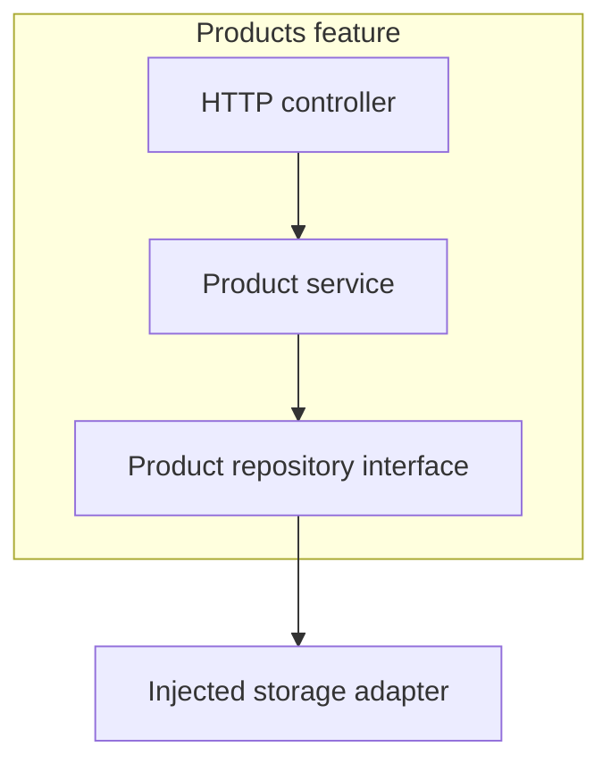
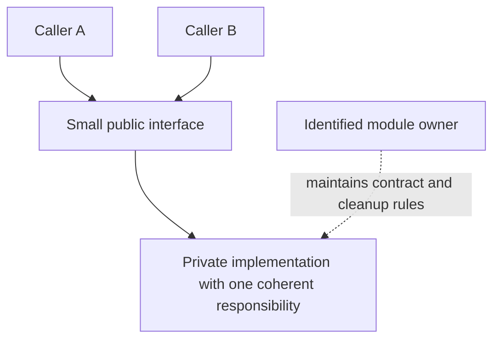
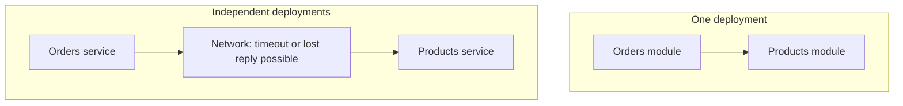
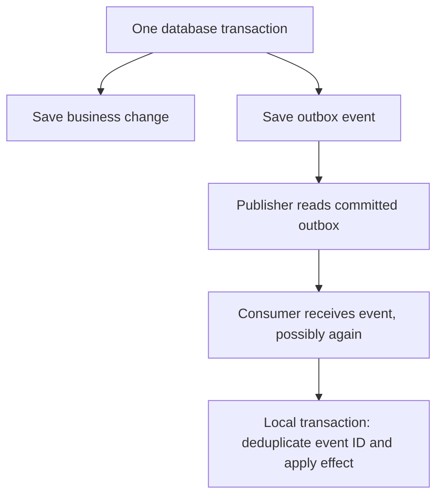
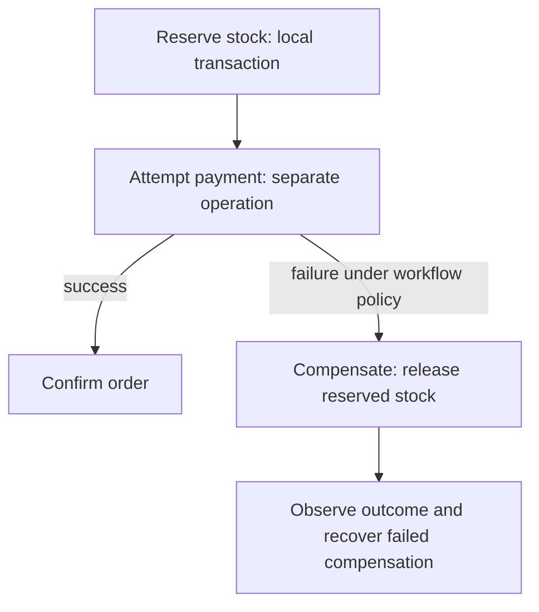
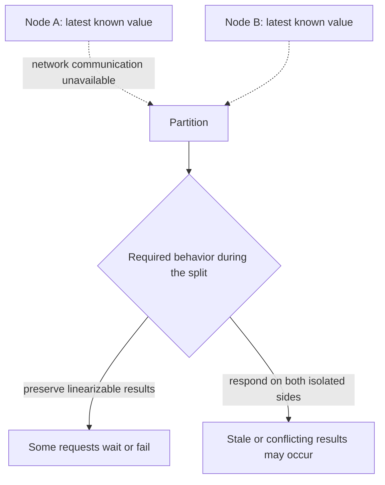
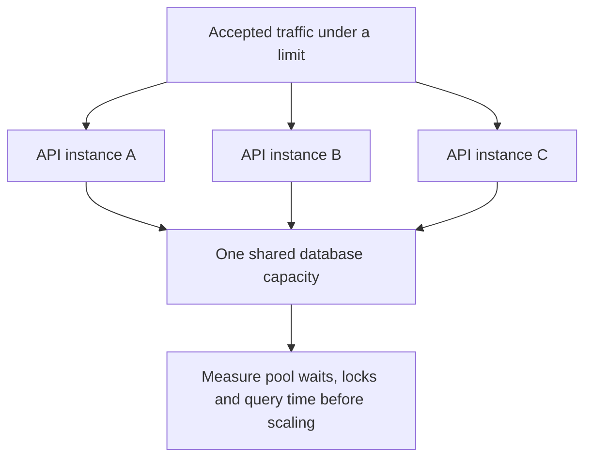

# Designing service architecture

<span class="notes-section-label">**Section 3 reading path:**</span> You have already separated routes, use cases and storage in Section 2. Review that application with the [layers/modules](#t18-q24) and [module contracts](#t18-q25) lessons. Then explain why one deployable application is still suitable. Read the other Core answers to understand the design options. The outbox, saga, CAP and advanced load exercises are later extensions; they are not required for the single-service Project 3 release. NestJS modules and providers follow the same dependency rules. The framework does not decide which component owns business rules or data.

For unfamiliar technical terms, use the [Section 3 vocabulary guide](./index.md#section-3-vocabulary).

Architecture is a set of decisions about **ownership, dependencies, state and failure**. These six questions extend the application boundaries and selected patterns from Section 2. The [design-pattern catalogue](./18-patterns.md) remains a reference, not an additional prerequisite; a catalogue of classes does not replace system design. Examples use Node.js 24 and the existing Express 5/PostgreSQL path. Distributed deployment is a design exercise until tested against real infrastructure.

<!-- tech-check: t18-q24; level: 3 -->

## How do layers and feature modules fit together?

*Study depth: Intermediate*

Level Up: L3 — Senior\
Tech Check level: ⭐⭐⭐

Source mapping: [R062](./requirements.md#r062), [R172](./requirements.md#r172).


<div class="notes-core-answer">

<p class="notes-core-answer__title">Core answer</p>

Group code by business feature, such as products or orders. Within a feature, separate HTTP handling, business operations and storage access. **Layers describe responsibilities; feature modules group related work.** You can use both together.

**What each module depends on matters more than its folder name.** Give a business service the repository or other components it needs. It should not need an Express request object or create its own database connection just to perform a business operation.

</div>

<span class="notes-section-label">**Put layers inside a feature**</span>

The feature groups related work. Its internal calls still separate transport, business rules and storage.




:::: details Deeper explanation and additional examples

A layer groups code by responsibility. A controller handles HTTP, an application service runs a use case, and a repository reads or writes stored data. A feature groups code that changes together: `products/` contains its router, service, validation and repository. You can organize features into layers.

```text
products/
  router.mjs        HTTP parsing, status and response mapping
  service.mjs       use cases, permissions and transaction boundary
  repository.mjs    parameterized persistence
composition.mjs     creates dependencies and connects the modules
server.mjs          opens the listener and owns shutdown
```

A business rule such as “price cannot be negative” belongs in the model or use case. A database constraint should also enforce it. Parse JSON at the HTTP boundary. Returning an ORM entity directly can expose internal fields and make API responses depend on database schema changes.

<span class="notes-section-label">**Worked example — inject the storage capability**</span>

```js [product-service.mjs]
import assert from 'node:assert/strict';

function createProductService({ products }) {
  return {
    async rename({ actor, id, name }) {
      if (
        !Array.isArray(actor?.permissions) ||
        !actor.permissions.includes('products:write')
      ) {
        throw new Error('forbidden');
      }
      if (typeof name !== 'string' || !name.trim() || name.length > 80) {
        throw new TypeError('invalid name');
      }
      const updated = await products.renameOwned(id, actor.tenantId, name.trim());
      if (!updated) throw new Error('not found');
      return { id: updated.id, name: updated.name };
    },
  };
}

const calls = [];
const service = createProductService({
  products: {
    async renameOwned(...args) {
      calls.push(args);
      return { id: args[0], name: args[2], internalCost: 99 };
    },
  },
});
const actor = { tenantId: 'acme', permissions: ['products:write'] };
assert.deepEqual(await service.rename({ actor, id: 'p1', name: ' New ' }), {
  id: 'p1',
  name: 'New',
});
await assert.rejects(service.rename({ actor: null, id: 'p1', name: 'New' }));
assert.deepEqual(calls, [['p1', 'acme', 'New']]);
```

For Learning Progress, the same shape is the existing `completeItem` operation calling an owner-scoped repository: HTTP parses the request, the use case checks the transition, and storage persists it atomically. Keep the existing item/session rules and public error codes. In NestJS, an injected provider supplies that repository; the controller remains an HTTP adapter.

The fake repository shows how dependencies are supplied and how the response selects public fields. This selection is often called DTO projection. The fake does not prove that the real database separates tenants. Its SQL update must include the tenant ID in the `WHERE` condition. Start with a small object contract; adding an interface for every function can make simple code harder to follow.

::::

<span class="notes-section-label">**Examiner follow-up — where does a transaction belong?**</span>

Put the transaction around the use case that must preserve a business rule, also called an invariant. Give each participating operation a repository that uses that transaction. If each repository call opens its own transaction, the whole use case cannot commit or roll back as one unit.

<span class="notes-section-label">**Practice and acceptance**</span>

Extract a product rename route into these boundaries. Accept only when the service imports no Express objects, unauthorized calls never reach persistence, the real query scopes by tenant and the response excludes internal fields. Add a failure test for a missing product. See [Express routing](https://expressjs.com/en/guide/routing.html) and [framework implementation](./16-frameworks.md).

---

<!-- tech-check: t18-q25; level: 3 -->

## What makes a module maintainable and reusable?

*Study depth: Intermediate*

Level Up: L2 — Software Engineer\
Tech Check level: ⭐⭐⭐

Source mapping: [R129](./requirements.md#r129), [R175](./requirements.md#r175).


<div class="notes-core-answer">

<p class="notes-core-answer__title">Core answer</p>

A maintainable module exposes a small, clear interface, has an identifiable owner and lets most changes stay inside the module. Explain not only its method names, but also its results, errors, shared state and cleanup rules.

**Reusable code should have one coherent responsibility.** Putting unrelated helpers in a `shared` folder does not automatically make them a useful abstraction. Share code when its callers need the same behavior and change rules, rather than only because the code looks similar.

</div>

<span class="notes-section-label">**Make the module boundary explicit**</span>

Callers rely on the public contract. Internal changes should preserve its results, failures and lifetime rules.




:::: details Deeper explanation and additional examples

Export application operations instead of exposing mutable data directly. Create and connect dependencies in one setup module, often called the composition root. Supply a clock, ID generator or remote client when tests need predictable behavior. You do not need to inject every built-in language operation. Document the repository’s results, missing-item behavior, ordering, concurrency rules and errors.

For example, the contract for `reserve(productId, quantity)` must answer several questions. Does it check and reduce stock atomically? Which error means insufficient stock? Does it accept an idempotency key to prevent duplicate effects? Is retrying safe? Without these answers, an in-memory replacement can behave differently from SQL even if both expose the same TypeScript signature.

Use consumer contract tests when several implementations share the boundary. Unit tests check policy; integration tests check the real adapter; a small end-to-end test checks wiring. Avoid a circular dependency where the service imports its router and the router imports the service: move shared domain concepts inward, rather than patching initialization order.

<span class="notes-section-label">**Design decision**</span>

A shared `Money` value object can keep currency and integer amounts together. A shared `BaseService` can become difficult to change if it assumes that every feature has identical authorization, retry and transaction rules. Start by combining small components. Add a shared abstraction when several callers need the same stable behavior. Document who may change that contract and how existing callers will move to a new version.

::::

<span class="notes-section-label">**Examiner follow-up — is Flux a backend architecture?**</span>

Flux describes unidirectional UI data flow: action → dispatcher/store → view. It can explain state transitions but does not define database transactions or independently deployed services. Keep the ladder's Flux comparison, while choosing a modular backend architecture for this course. CQRS separates commands and queries; it neither requires event sourcing nor makes authorization optional.

<span class="notes-section-label">**Practice and acceptance**</span>

Write a one-page module contract and run the same success/not-found/conflict tests against a fake and the actual adapter. Accept only when semantics match and a circular-dependency check shows no feature importing another feature's private implementation. References: [Node package entry points](https://nodejs.org/docs/latest-v24.x/api/packages.html#package-entry-points), [testing contracts](./15-testing.md#t15-q02), [Meta Flux archive](https://github.com/facebookarchive/flux/tree/main/examples/flux-concepts).

---

<!-- tech-check: t18-q26; level: 3 -->

## When should a modular monolith become microservices?

*Study depth: Intermediate*

Level Up: L3 — Senior\
Tech Check level: ⭐⭐⭐

Source mapping: [R064](./requirements.md#r064), [R173](./requirements.md#r173), [R174](./requirements.md#r174), [R183](./requirements.md#r183).


<div class="notes-core-answer">

<p class="notes-core-answer__title">Core answer</p>

A modular monolith keeps clear internal modules but deploys them together. **Keep one deployment when it meets the requirements** and lets local database transactions protect the needed rules.

Consider a separate service when a feature needs independent team ownership, failure isolation or scaling enough to justify the extra operating work. **A remote call can fail while the other service keeps running.** You must handle timeouts, uncertain results and compatible request and response formats across independently released versions. Splitting folders into services is not a benefit by itself.

</div>

<span class="notes-section-label">**See the extra remote boundary**</span>

A modular monolith makes local calls. Splitting a deployment introduces a network boundary with independent failures.




:::: details Deeper explanation and additional examples

A modular monolith has clear internal interfaces but is deployed as one application. Microservices can be deployed separately and own their data. Service-oriented architecture (SOA) is a broader approach to connecting services. It does not require a particular enterprise service bus (ESB) product. Event-driven architecture connects producers and consumers through events, either inside one application or between services.

Before separating invoicing into a service, identify its team owner, API/event contract and data owner. Plan data migration, including filling existing records into the new system (backfilling). Set a service-level objective: a measurable reliability or performance target. If every change still requires six services to deploy together and share the same tables, the split adds network failures without useful independence.

| Concern | Direct in-process call | Remote service call |
|---|---|---|
| Failure | Return or throw; process may crash | Also timeout, partial response and unknown outcome |
| Contract | Compiler/tests within one release | Backward-compatible wire format across releases |
| State | Local transaction may span modules | Separate owners; explicit consistency workflow |
| Diagnosis | Stack trace and local logs | Correlation, trace propagation and dependency metrics |

Give an outgoing call a deadline shorter than the caller’s remaining time. Retry only failures known to be temporary, and only when repeating the operation is safe. Limit attempts and add a small random delay, called jitter. Give each dependency separate capacity limits, sometimes called bulkheads, so one failure cannot use every socket or work slot. A circuit breaker temporarily stops calls after repeated failures. It does not store work or make changes transactional. Report failure rather than inventing a successful result.

Some advanced tools may help later. Service discovery finds healthy instances. An API gateway routes incoming requests. A service mesh can apply network policies between services, but also adds operating work. A strangler migration replaces an old system one route or capability at a time, with checks and a way to reverse each step. You do not need Kubernetes or a service mesh for this exercise.

::::

<span class="notes-section-label">**Examiner follow-up — can I share an authentication database?**</span>

Prefer a documented identity contract over arbitrary table access. Even when storage is initially shared, define ownership and compatible migrations; another service must not silently mutate your private schema. Authentication is covered in the [dedicated chapter](./13-authentication-and-authorization.md).

<span class="notes-section-label">**Practice and acceptance**</span>

Write an architecture decision record (ADR) comparing one application with two services. Include three possible failures, call deadlines, contract versions, data migration, rollback and operating cost. Explain what evidence would make you change the decision. A diagram alone is not enough. Reference: [Microsoft microservices architecture](https://learn.microsoft.com/en-us/azure/architecture/guide/architecture-styles/microservices), [resilient systems worked notes](../module-12-resilient-distributed-systems.md). Reference: [Microsoft microservices architecture](https://learn.microsoft.com/en-us/azure/architecture/guide/architecture-styles/microservices), [resilient systems worked notes](../module-12-resilient-distributed-systems.md).

---

<!-- tech-check: t18-q27; level: 3 -->

## How do outbox, idempotency and sagas preserve consistency?

*Study depth: Advanced*

Level Up: L4 — Lead\
Tech Check level: ⭐⭐⭐

Source mapping: [R099](./requirements.md#r099), [R100](./requirements.md#r100).


<div class="notes-core-answer">

<p class="notes-core-answer__title">Core answer</p>

An outbox is a database record saying that an event needs to be published. **Save the business change and its outbox record in the same local transaction.** A separate publisher sends the event later. This prevents a crash from leaving a committed change with no saved publication intent.

**Delivery can still repeat.** Make consumers idempotent: processing the same event again must not repeat its business effect. Record the event's identity with the consumer's local change when appropriate.

A saga coordinates a workflow across several local transactions. If a later step fails, it runs explicit compensating actions, such as releasing reserved stock. Compensation is a new business action, not an automatic rollback of everything across services.

</div>

<span class="notes-section-label">**Commit publication intent with the change**</span>

The publisher may send twice if it crashes before recording delivery. The consumer therefore records identity with its own local effect.




<span class="notes-section-label">**See compensation as another action**</span>

This simplified saga releases stock after a later failure. The release is a business operation with its own possible failures.




:::: details Deeper explanation and additional examples

Writing an order, then publishing an event can crash between the two. Publishing first can announce an order that never commits. An outbox stores both records in the same database commit. A relay publishes pending events, then marks delivery. A crash after broker acceptance but before marking causes duplicates, so each consumer records the event ID in the same transaction as its own database effect.

```sql [outbox-boundary.sql]
BEGIN;
INSERT INTO orders (id, status) VALUES ('order-1', 'pending');
INSERT INTO outbox (id, aggregate_id, event_type, payload)
VALUES ('event-1', 'order-1', 'OrderPlaced', '{"orderId":"order-1"}'::jsonb);
COMMIT;
```

This SQL fragment assumes that the tables and constraints already exist. A real publisher needs batch limits, clear responsibility for claimed work, retry rules and a policy for messages that repeatedly fail. Set a retention period for old records. Each consumer stores a unique `(consumer_name, event_id)` receipt with its database change. If the receipt already exists, it skips the change. The receipt and change must use the same transaction.

An external payment or email cannot be part of that local database transaction. Use the provider’s duplicate-protection mechanism and save its operation ID. If the result is unknown, check what actually happened before retrying; this is called reconciliation. **A timeout does not prove the external effect failed.** To preserve event order, use a version or sequence for each business entity and define how events are partitioned. Timestamps from different machines do not provide a reliable global order.

For example, a saga can reserve stock, authorize payment and confirm an order. If payment fails, it releases the reservation. That release is a new business action, not a rollback across databases. It may no longer be valid after the item has shipped. Save the saga’s progress, retry only safe steps, and send cases that cannot be recovered automatically for human review.

::::

<span class="notes-section-label">**Practice and acceptance**</span>

In an owned database/broker fixture, crash after publish but before marking delivery. Replay the event twice and prove one consumer mutation. Add a payment-timeout case that stays pending reconciliation rather than charging blindly again. Accept only with durable receipts, unique constraints and observed recovery. References: [AWS transactional outbox](https://docs.aws.amazon.com/prescriptive-guidance/latest/cloud-design-patterns/transactional-outbox.html), [AWS saga orchestration](https://docs.aws.amazon.com/prescriptive-guidance/latest/cloud-design-patterns/saga-orchestration.html).

---

<!-- tech-check: t18-q28; level: 3 -->

## What does availability versus consistency actually mean?

*Study depth: Advanced*

Level Up: L4 — Lead\
Tech Check level: ⭐⭐⭐

Source mapping: [R102](./requirements.md#r102).


<div class="notes-core-answer">

<p class="notes-core-answer__title">Core answer</p>

A network partition means parts of a distributed system cannot communicate. During that split, **the system cannot guarantee both linearizable results and a successful response to every request at every non-failing node**.

Linearizable means operations behave like they use one shared copy, with each taking effect at a single point between its call and response. A read starting after a completed write must respect that write. To preserve this guarantee during a partition, some requests may need to wait or fail. Responding everywhere may instead require allowing stale or conflicting data.

**CAP describes behavior during a partition**, not a permanent choice of any two letters. Its definition of availability is also different from an ordinary monthly uptime target.

</div>

<span class="notes-section-label">**Picture a network partition**</span>

With communication broken, both sides cannot simply coordinate a single current value. The policy determines which requests wait, fail or risk stale data.




:::: details Deeper explanation and additional examples

Linearizability means each operation appears to take effect at one moment between its start and response, in real-time order. Under CAP, availability means every request to a node that has not failed eventually receives a response. This differs from a monthly uptime percentage. Decide which operations must wait or fail during a network partition and which may return older data.

For a public catalogue, a stale description may be acceptable with a freshness budget. For spending the last unit of stock, accepting conflicting writes on both sides can oversell; a single authoritative owner or coordinated transaction may reject requests during a partition. “Eventual” consistency promises convergence under the model's assumptions, not a bounded delay by itself.

ACID consistency means database changes preserve the declared rules. Transaction isolation controls how concurrent transactions affect one another. CAP consistency is a different concept. PostgreSQL Read Committed gives each statement a new snapshot. Serializable may reject a transaction so the application can retry the whole operation. A replica can still return older data after the primary has committed a write.

::::

<span class="notes-section-label">**Examiner follow-up — how do users read their own writes?**</span>

Send the follow-up read to the primary, return the committed data in the write response, or use a version token with an explicit wait/fallback policy. Do not promise that a replica immediately shows a write unless that guarantee has been verified.

<span class="notes-section-label">**Practice and acceptance**</span>

For catalogue, checkout and audit history, specify allowed staleness, conflict policy and behavior during a partition. Accept when every operation has a clear success/failure/pending meaning and an executable two-client concurrency test is proposed. References: [Gilbert/Lynch CAP proof](https://www.cs.princeton.edu/courses/archive/spr22/cos418/papers/cap.pdf), [PostgreSQL 18 isolation](https://www.postgresql.org/docs/18/transaction-iso.html).

---

<!-- tech-check: t18-q29; level: 3 -->

## How do you design for load without guessing?

*Study depth: Advanced*

Level Up: L4 — Lead\
Tech Check level: ⭐⭐⭐

Source mapping: [R101](./requirements.md#r101), [R145](./requirements.md#r145).


<div class="notes-core-answer">

<p class="notes-core-answer__title">Core answer</p>

Define realistic traffic and acceptable response times and error rates. Measure which resource limits the system, then change one bottleneck and compare the same workload again.

**Adding instances helps only if the bottleneck can benefit from them.** More API instances can increase pressure on an already saturated database rather than fix it. Limit how much work you accept, and use backpressure to slow producers when consumers cannot keep up. These controls protect both the Node process and its dependencies.

</div>

<span class="notes-section-label">**Locate the shared bottleneck**</span>

More API replicas do not create more database capacity. Measure both admission and the shared dependency.




:::: details Deeper explanation and additional examples

Performance describes behavior under a particular workload. Scalability describes how that behavior changes as load and resources increase. Measure request rate, latency percentiles, errors, event-loop delay, CPU, memory, pool wait and dependency time together. For example, p95 latency is the value at or below which 95% of requests finish. An average can hide slow requests. Adding API copies can worsen a saturated database by creating more connections.

For a stable system, Little's law relates average in-flight work, throughput and average time in the measured boundary. It does not predict tail latency or a safe queue size under overload. CPU-heavy work may need a bounded worker pool; asynchronous database calls usually do not benefit from worker threads. See [concurrency capacity ownership](./09-concurrency.md#t09-q08).

A cache reduces repeated work but may return older data. Limit its size and time-to-live (TTL). Include user or tenant scope in keys when required. Prevent many requests from refreshing the same missing value at once; one shared refresh is sometimes called single-flight. Define when values are removed or updated. A timeout or cache miss must not trigger unlimited backend calls. Do not retain permission decisions forever or share one user’s private response with another tenant.

For stateful bottlenecks, examine query plans and lock duration before adding a cache. For stateless request handling, test horizontal replicas behind a health-aware load balancer. Track queue age as well as depth; a bounded queue still needs deadline handling, rejection and fair ownership. Autoscaling needs startup time, a maximum and a dependency budget.

::::

<span class="notes-section-label">**Practice and acceptance**</span>

Record baseline load, dataset and hardware; impose one slow dependency; then compare a bounded-admission policy with uncontrolled queuing. Accept with latency/error/resource graphs and an explanation of rejected work. Do not claim a production SLO from a laptop run. Reference: [AWS compute load distribution](https://docs.aws.amazon.com/wellarchitected/latest/reliability-pillar/rel_withstand_component_failures_load_balancing.html), [Node performance hooks](https://nodejs.org/docs/latest-v24.x/api/perf_hooks.html).

## Revision and practical checkpoint

Explain the ownership boundary before naming a pattern. For one Products API, draw the module dependencies, identify the transaction, choose one failure to reject, and show how a duplicate command is handled. Keep the monolith unless you can justify extraction with a concrete requirement. The acceptance criteria above are a learner backlog; authored material and local snippet checks do not complete it.

### Mixed practice

1. A product update commits, but the process dies before notifying billing. What changes?
2. The team proposes six services sharing one schema and one release. What evidence would justify this?

<span class="notes-section-label">**Answer guide — read after attempting both cases**</span>

1. Commit a business change plus outbox intent locally, relay with durable retry, and deduplicate the consumer effect. A crash after publication can still duplicate delivery; do not promise exactly-once external effects.
2. Require a concrete ownership/scaling/isolation need and an independent contract/recovery plan. Otherwise preserve explicit modules in one deployable rather than pay the network cost without autonomy.
