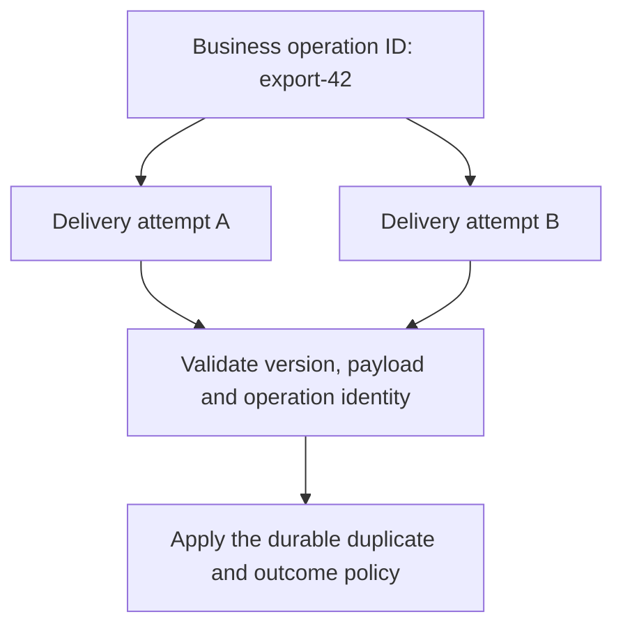
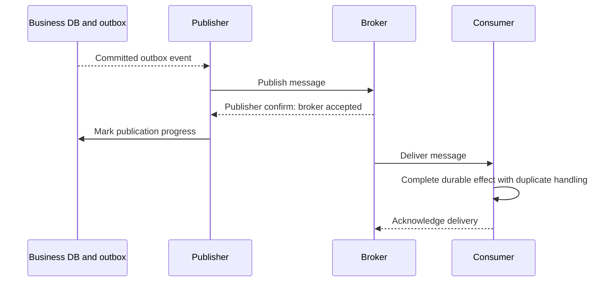
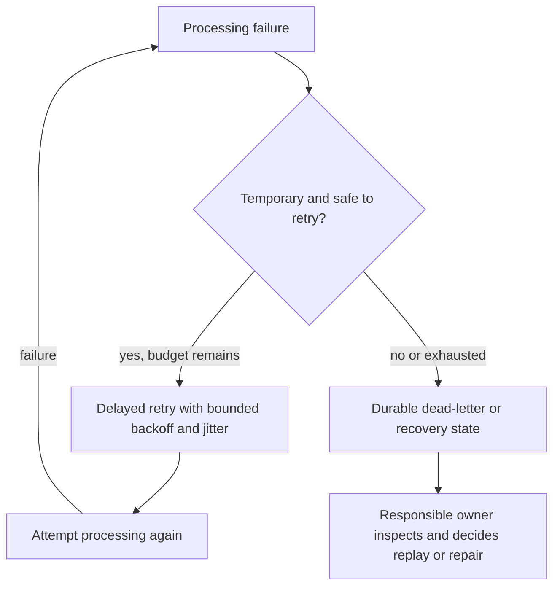
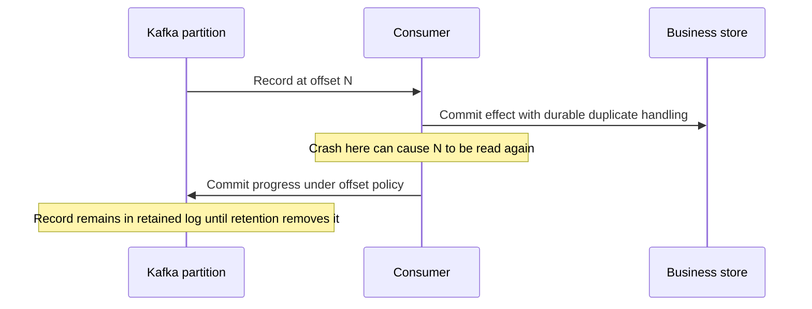
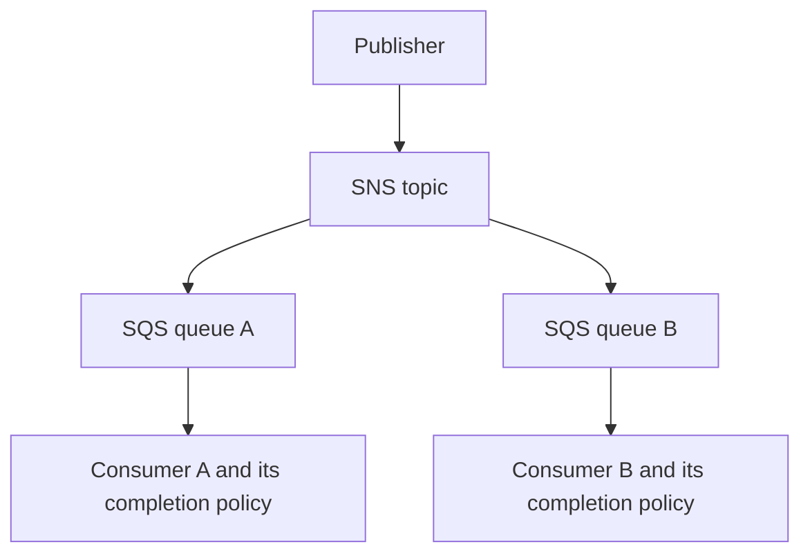
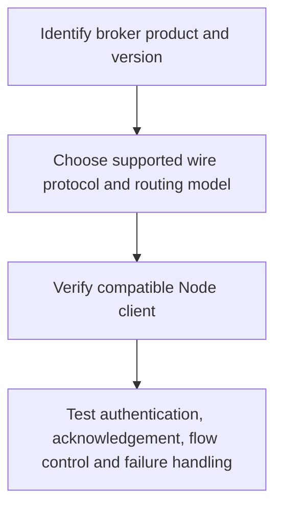

# Messaging and durable background work

Use PostgreSQL and the existing RabbitMQ job adapter as the primary implementation. Kafka, ActiveMQ/Artemis, SQS and SNS are alternatives for particular contracts, not six compulsory stacks. The canonical [durable jobs lab](../jobs-and-schedules.md) records its exact client/broker versions; select a supported patched broker for deployment. References checked 2026-11-05.

<!-- tech-check: t19-q01; level: 5 -->

## What contract must a message describe?

*Study depth: Intermediate*

Level Up: L3 — Senior\
Tech Check level: ⭐⭐⭐⭐⭐

Source mapping: [R059](./requirements.md#r059).


<div class="notes-core-answer">

<p class="notes-core-answer__title">Core answer</p>

Before choosing a broker, define who sends the message, who handles it, its fields and version, its operation ID, ordering rules and failure recovery. **A command asks for work; an event reports something that happened.** The broker transports messages, but your application decides what successful processing means.

**A delivery ID may differ from the business operation's ID.** Two delivery attempts can request the same export or payment. Keep a stable operation identity when repeated delivery must not repeat the effect, and define how duplicates and uncertain outcomes are handled.

</div>

<span class="notes-section-label">**Separate business identity from delivery identity**</span>

Several delivery attempts can carry the same operation. Duplicate-effect handling follows the stable operation identity.




:::: details Deeper explanation and additional examples

A work queue distributes jobs among consumers; a publish/subscribe topic fans notifications to subscriptions; a retained partitioned log supports replay and independent consumer positions. These overlap in products but differ in ownership. An in-process EventEmitter supplies neither persistent storage nor cross-process recovery.

```js [message-contract.mjs]
import assert from 'node:assert/strict';
function parseEvent(bytes) {
  if (!Buffer.isBuffer(bytes) || bytes.length > 8192)
    throw new TypeError('message size');
  const value = JSON.parse(bytes.toString('utf8'));
  if (
    !value ||
    Array.isArray(value) ||
    Object.keys(value).sort().join(',') !== 'id,kind,tenant,v' ||
    value.v !== 1 ||
    value.kind !== 'catalogue.refresh' ||
    typeof value.id !== 'string' ||
    !/^[a-z0-9-]{1,64}$/.test(value.id) ||
    typeof value.tenant !== 'string' ||
    !/^[a-z0-9-]{1,40}$/.test(value.tenant)
  ) {
    throw new TypeError('message schema');
  }
  return Object.freeze({
    v: 1,
    id: value.id,
    kind: value.kind,
    tenant: value.tenant,
  });
}
const event = { v: 1, id: 'operation-1', kind: 'catalogue.refresh', tenant: 'a' };
assert.equal(parseEvent(Buffer.from(JSON.stringify(event))).id, 'operation-1');
assert.throws(() => parseEvent(Buffer.from(JSON.stringify({ ...event, v: 2 }))));
assert.throws(() =>
  parseEvent(Buffer.from(JSON.stringify({ ...event, isAdmin: true }))),
);
assert.throws(() => parseEvent(Buffer.alloc(8193)));
```

This is a deliberately small envelope model, not the canonical lab's UUID schema. Production schema changes need backward-compatible consumers, explicit version routing or a coordinated migration. Project a safe DTO and bound nested/decoded payload work; parsing success does not authenticate a producer or authorize a tenant. Use scoped broker identities and current application policy.

At-most-once processing can lose work after removal; at-least-once processing can repeat it. Broker “exactly once” features operate within stated boundaries, not automatically across SQL and payment/email APIs. Persist a stable operation ID and durable consumer receipt with the local effect. Retain enough status to reconcile unknown outcomes after a crash.

::::

<span class="notes-section-label">**Practice and acceptance**</span>

Specify an export command and its completion event. Test invalid/oversize/old-version messages and two delivery IDs for one operation. Accept with an explicit owner, duplicate policy, retention window and compatible change plan. References: [RabbitMQ reliability](https://www.rabbitmq.com/docs/reliability), [Kafka design](https://kafka.apache.org/42/design/design/).

---

<!-- tech-check: t19-q02; level: 5 -->

## How do RabbitMQ confirms, acknowledgements and the outbox fit together?

*Study depth: Intermediate*

Level Up: L3 — Senior\
Tech Check level: ⭐⭐⭐⭐⭐

Source mapping: [R059](./requirements.md#r059), [R189](./requirements.md#r189).


<div class="notes-core-answer">

<p class="notes-core-answer__title">Core answer</p>

Save the business change and an outbox record in one local database transaction. The outbox records that a message needs to be published. A publisher sends it and waits for the broker's confirmation. A consumer acknowledges its delivery only after completing the effect or handing recovery to durable storage under an explicit agreement.

**A publisher confirm means broker acceptance; a consumer acknowledgement means the consumer permits that delivery to be removed.** Neither proves every later business step succeeded. A crash between publishing and marking the outbox, or between committing an effect and acknowledging, can cause repeats. Handle those duplicates deliberately.

</div>

<span class="notes-section-label">**Observe both broker and consumer milestones**</span>

Broker confirmation and consumer acknowledgement have different meanings. Either crash window can lead to a repeat.




:::: details Deeper explanation and additional examples

RabbitMQ routes messages through exchanges/bindings to queues. A durable queue and persistent message are configuration choices; a publisher confirmation establishes broker acceptance under its durability policy, not consumer completion. Mandatory routing/returned-message handling detects an unroutable publication that a simple successful send call can miss.

The implementation owner remains the existing lab, included directly here so the code stays aligned:

<<< ../../workbench/node-js/messaging/jobs-lab/rabbit.mjs

Copy the module into the lab's isolated ESM setup with its reviewed amqplib/Zod/pg versions. Create its three tables through a migration, then follow [the complete producer/worker composition](../jobs-and-schedules.md). The adapter deliberately allows one publisher owner and prefetch one; parallel calls on its shared confirm/return channel would violate its correlation assumption. Increase throughput only after introducing an appropriate bounded publisher protocol.

`applyOnce` commits receipt and SQL effect together. A consumer crash after commit/before ack causes redelivery and no second local effect. A relay crash after publish/before marking its outbox row can publish again. A payment needs a provider idempotency key/status reconciliation as well; the SQL receipt cannot atomically include the provider's transaction.

The sample relay holds a row lock while confirming publication. That keeps claim ownership simple but occupies a database client during network work. For scale, use a reviewed durable claim/lease or CDC design with expiry/fencing/recovery; do not replace ownership with an unbounded in-memory array. The simple rollback path is a teaching baseline, not exhaustive broken-connection cleanup.

::::

<span class="notes-section-label">**Practice and acceptance**</span>

Run the canonical lab against owned RabbitMQ/PostgreSQL. Verify duplicate effect suppression, unroutable publication failure, redelivery after channel closure and orderly shutdown. Accept with actual broker/DB evidence, released connections and no claim of atomic SQL/broker delivery. References: [RabbitMQ confirms/acks](https://www.rabbitmq.com/docs/confirms), [AMQP client API](https://amqp-node.github.io/amqplib/channel_api.html), [transactional outbox](./18-architecture.md#t18-q27).

---

<!-- tech-check: t19-q03; level: 5 -->

## How do retries, dead letters and failover avoid an outage loop?

*Study depth: Advanced*

Level Up: L4 — Lead\
Tech Check level: ⭐⭐⭐⭐⭐

Source mapping: [R097](./requirements.md#r097).


<div class="notes-core-answer">

<p class="notes-core-answer__title">Core answer</p>

Separate permanent failures, such as invalid messages, from temporary failures that may succeed later. **Limit retries and spread them out with delays and random variation**, often called jitter, so recovering clients do not all retry at once.

**Immediately rejecting and requeueing the same message can worsen an outage.** Dead-letter storage holds messages that need another recovery path; it also needs a responsible operator and rules for inspecting or replaying them. Keep recovery state durable, and test how the actual broker setup handles server loss and reconnection. Reconnecting one client does not prove a multi-server failover design works.

</div>

<span class="notes-section-label">**Break the requeue loop**</span>

A bounded recovery path distinguishes invalid work from a transient dependency problem.




:::: details Deeper explanation and additional examples

A malformed schema or permanently forbidden action should not receive endless transient retries. A temporary dependency outage can justify bounded retry, but admission, timeout and maximum age must still protect the dependency. Keep the stable business ID across attempts. Retry metadata is untrusted input too; bound attempt count, body size and timestamp policy.

The canonical adapter confirms its replacement retry/dead-letter publication before acking the original. Its classic-queue TTL/dead-letter demonstration is not a loss-free failover design: dead-letter transfer can fail when the destination is unavailable. For stronger durability, evaluate supported quorum-queue dead-letter policies and capacity settings, or a database-backed scheduler that retains intent until a confirmed handoff. A dead-letter consumer must not replay poison work blindly.

Failover needs replicated durable state, quorum/leader policy, tested reconnect and pending-operation semantics. A cluster with nodes on one host is not independent failure-zone resilience. A lost connection can leave publisher acceptance uncertain: reconnect, redeclare/verify compatible topology, publish the same operation ID under its duplicate policy and alert when recovery expires. Backoff must be bounded and cancelled on shutdown.

For Kafka, replication factor, minimum in-sync replicas and producer acknowledgements affect durability/availability. For SQS, the managed service owns infrastructure redundancy while the application still owns visibility/retry/effect semantics. Backups and disaster recovery are different from automatic leader replacement; test recovery time and possible data loss separately.

::::

<span class="notes-section-label">**Practice and acceptance**</span>

Inject dependency failure, poison input, broker disconnect and post-commit response loss. Accept with capped attempts, observable oldest age/dead letters, one local business effect, deliberate replay authority and an observed cleanup path. Multi-node partition/failover remains a separate exercise from the one-broker lab. References: [RabbitMQ quorum queues](https://www.rabbitmq.com/docs/quorum-queues), [dead-letter safety](https://www.rabbitmq.com/docs/dlx), [AWS retry guidance](https://docs.aws.amazon.com/prescriptive-guidance/latest/cloud-design-patterns/retry-backoff.html).

---

<!-- tech-check: t19-q04; level: 5 -->

## How is Kafka consumption different from deleting queue messages?

*Study depth: Intermediate*

Level Up: L3 — Senior\
Tech Check level: ⭐⭐⭐⭐⭐

Source mapping: [R059](./requirements.md#r059), [R190](./requirements.md#r190).


<div class="notes-core-answer">

<p class="notes-core-answer__title">Core answer</p>

Kafka stores records in retained logs split into partitions. Reading a record does not remove it. A consumer group tracks its position in each partition using offsets. **Ordering applies within a partition**, and a rebalance can move responsibility for that partition to another consumer.

**Saving an offset before the business effect is durable can skip unfinished work after a restart.** Saving it afterward can cause the work to run again if the process crashes between those steps. Preserve a stable operation ID and durable duplicate handling where required; an offset is a log position, not automatically a business-operation identity.

</div>

<span class="notes-section-label">**See the offset crash window**</span>

Recording the effect before the offset avoids claiming unfinished work is done, but duplicate processing remains possible after a crash.




:::: details Deeper explanation and additional examples

A key chooses a partition according to the producer's partitioning policy. Related aggregate updates need a consistent key and a version/conflict policy; there is no automatic global order across partitions. Different groups can replay the same retained log independently, subject to retention/compaction. Compaction keeps relevant keyed history under its contract, not every event forever.

Use a reviewed Node client compatible with your broker/security/authentication setup. Configure bootstrap servers, TLS/SASL, client/group IDs and offset/reset policy. Create a bounded test topic and publish keyed records; observe partition/offset before adding concurrency. Kafka 4.x uses its documented controller model; do not copy obsolete ZooKeeper setup steps into a new deployment blindly.

A next-offset calculation uses integers wider than JavaScript Number can safely represent:

```js [kafka-offset.mjs]
import assert from 'node:assert/strict';
function nextOffset(offset) {
  if (typeof offset !== 'string' || !/^(0|[1-9][0-9]{0,18})$/.test(offset)) {
    throw new TypeError('invalid offset');
  }
  const value = BigInt(offset);
  if (value >= 9223372036854775807n) throw new RangeError('offset exhausted');
  return (value + 1n).toString();
}
assert.equal(nextOffset('9007199254740993'), '9007199254740994');
assert.throws(() => nextOffset('1.5'));
assert.throws(() => nextOffset('-1'));
```

For a real database consumer, commit its receipt/effect, then advance the relevant partition position according to the client's API. Do not skip a failed record by committing a later offset accidentally. Bound per-partition concurrency and handle revocation/rebalancing so a stale owner cannot keep making unauthorized effects. Long handlers need the client's documented heartbeat/poll strategy. An offset is a log position, not a globally stable business operation ID.

Kafka transactions can coordinate supported Kafka writes/offsets; they do not automatically include an arbitrary SQL database. A full Kafka implementation is an optional alternative here; independent consumption/replay/effect troubleshooting is the learning objective.

::::

<span class="notes-section-label">**Practice and acceptance**</span>

In an owned topic/group, stop after a SQL commit but before offset commit, restart and prove duplicate suppression. Rebalance while work is active and explain ownership. Accept with observed partition order, replay boundaries and no lost effect; the pure offset fixture is not a broker test. References: [Kafka design and guarantees](https://kafka.apache.org/42/design/design/), [Kafka quickstart](https://kafka.apache.org/42/getting-started/quickstart/).

---

<!-- tech-check: t19-q05; level: 5 -->

## When do SQS and SNS fit a Node service?

*Study depth: Intermediate*

Level Up: L3 — Senior\
Tech Check level: ⭐⭐⭐⭐⭐

Source mapping: [R059](./requirements.md#r059).


<div class="notes-core-answer">

<p class="notes-core-answer__title">Core answer</p>

**SQS provides managed queues for workers; SNS distributes notifications to subscribers.** With SNS sending to separate SQS queues, independent consumers can each build and process their own backlog.

**Receiving a notification does not prove its business effect completed.** Configure delivery, retry, visibility and acknowledgement rules for the actual trigger or client. Repeated delivery still needs safe duplicate handling, and each consumer needs clear responsibility for durable completion and recovery.

</div>

<span class="notes-section-label">**Give each subscriber its own backlog**</span>

SNS fan-out to separate SQS queues lets independent consumers make progress and recover separately.




:::: details Deeper explanation and additional examples

An SQS worker receives messages, hides them for a visibility interval, commits its effect and deletes using the current receipt handle. Standard queues allow duplicates and best-effort ordering. Extend visibility deliberately for bounded long work; a failed extension can permit overlapping consumers. The latest receipt handle identifies a delivery attempt, not the business event. Long polling reduces empty receives; batch APIs require inspecting each entry's failure result.

FIFO message-group IDs serialize within the chosen group; deduplication has a defined window and does not give universal exactly-once database/payment execution. Choose group keys from actual ordering needs; one group for everything can limit throughput. Redrive limits, retention and dead-letter alarms need a recovery owner.

For a sandbox setup, define an SNS topic, one SQS queue per independent consumer and a narrow queue resource policy permitting only the intended topic to send. Add the subscription/filter policy and decide whether SNS wraps the payload or uses raw delivery; parse the configured envelope, not whichever example is convenient. Scope producer/worker IAM actions and resources separately and configure encryption/key permissions as needed.

A Node SDK v3 worker uses an injected SQS client, bounded receive count/WaitTimeSeconds, schema validation, an idempotent use case and DeleteMessage only after completion. The [Lambda partial-batch adapter](./20-serverless.md#t20-q03) is a different event-source contract: do not manually apply HTTP-response or poller acknowledgment semantics to it. Reuse its worked adapter rather than add a competing implementation.

::::

<span class="notes-section-label">**Practice and acceptance**</span>

Prepare a scoped topology/configuration locally; in an authorized sandbox test topic fan-out, duplicate delivery, filter/envelope choice, visibility expiry and dead-letter redrive. Accept with denied unrelated producers, durable receipts and cleanup/cost evidence. No AWS resource creation is part of this notes task. References: [SQS standard delivery](https://docs.aws.amazon.com/AWSSimpleQueueService/latest/SQSDeveloperGuide/standard-queues.html), [visibility timeout](https://docs.aws.amazon.com/AWSSimpleQueueService/latest/SQSDeveloperGuide/sqs-visibility-timeout.html), [SNS→SQS](https://docs.aws.amazon.com/sns/latest/dg/sns-sqs-as-subscriber.html).

---

<!-- tech-check: t19-q06; level: 5 -->

## What should you know about ActiveMQ and Artemis before choosing them?

*Study depth: Intermediate*

Level Up: L3 — Senior\
Tech Check level: ⭐⭐⭐⭐⭐

Source mapping: [R059](./requirements.md#r059).


<div class="notes-core-answer">

<p class="notes-core-answer__title">Core answer</p>

**ActiveMQ Classic and Apache Artemis are different broker implementations.** Identify the exact product and version before selecting configuration or client code. Check its supported wire protocol—the rules clients use to exchange messages—and how queues, topics or addresses route those messages.

**A Java/JMS example is not automatically a Node client's API.** Verify the chosen Node client's authentication, delivery acknowledgement, flow-control and failure behavior. Similar product or protocol names do not guarantee compatible message handling.

</div>

<span class="notes-section-label">**Verify the real protocol boundary**</span>

Product choice, wire protocol and Node client are distinct compatibility decisions.




:::: details Deeper explanation and additional examples

An existing enterprise integration may justify Classic or Artemis, especially when JMS/Jakarta Messaging, AMQP 1.0 or other supported protocols already define the contract. Check the selected broker's actual protocol support and Node client compatibility; RabbitMQ's AMQP 0-9-1 library cannot be substituted for an AMQP 1.0 client merely because both say AMQP.

For an Artemis exercise, start an owned instance from its official versioned setup, create an authenticated scoped user and configure an address/queue with the intended routing type. Anycast normally distributes to one eligible queue/consumer path; multicast supports fan-out according to address/queue configuration. Configure persistence, acknowledgment/settlement and redelivery/dead-letter policy through that broker's documented settings. Keep management interfaces private and select TLS in a hosted environment.

In a Node adapter, validate the protocol message and settle only after the durable use case completes. Handle connection/session/link errors and bound in-flight deliveries with the client's credit/backpressure mechanism. Reconnect/failover can produce uncertainty; business receipts remain necessary. Do not describe one-node reconnection as proof of replicated high availability.

| Requirement | Primary/alternative decision |
|---|---|
| Bounded background jobs in this course | Existing PostgreSQL/RabbitMQ lab |
| Retained replayable partitioned history | Evaluate Kafka's log/group model |
| AWS-managed independent workers/fan-out | Evaluate SQS/SNS and IAM/cost |
| Existing JMS/protocol-centered enterprise integration | Verify Classic/Artemis product and protocol contract |

::::

<span class="notes-section-label">**Practice and acceptance**</span>

Write a concrete adapter contract and an owned setup plan: product/version, protocol/client, address/queue, auth/TLS, settlement, retry and cleanup. Optional hands-on must prove routing, failed-handler redelivery and bounded stop with the chosen client. Reference: [Artemis manual](https://artemis.apache.org/components/artemis/documentation/latest/), [ActiveMQ Classic protocols](https://activemq.apache.org/components/classic/documentation/protocols).

## Revision and mixed practice

Try each question without opening its answer. Explain the reason, not just the term; then expand **Show answer** to check. Diagram questions link back to the visual so you can trace its parts and arrows.

<!-- revision-covers: t19-q01 -->

<span class="notes-section-label">**1. Scenario — A publisher timed out after the broker accepted an outbox event. Should a retry use a new business ID?**</span>

::: details Show answer

Retain the stable operation ID and reconcile/retry under the duplicate contract; a new ID can bypass deduplication.

[Revisit the explanation and examples](#t19-q01).

:::


---

<!-- revision-covers: t19-q01 -->

<span class="notes-section-label">**2. Compare — How does a command differ from an event, and why can a delivery ID be insufficient to deduplicate the business operation?**</span>

::: details Show answer

**A command requests work; an event reports something that happened.** Define version, payload, ordering and recovery; keep business-operation identity distinct from delivery-attempt identity. Several deliveries can ask for one operation, while retries with newly invented business IDs can bypass duplicate protection. Define payload/version, ordering, authority and durable outcome meaning before selecting the broker.

[Revisit the explanation and examples](#t19-q01).

:::


---

<!-- revision-covers: t19-q02 -->

<span class="notes-section-label">**3. Explain diagram — Trace the [outbox and broker diagram](#t19-q02). What do publisher confirm and consumer acknowledgement each prove, and where can a crash still cause repeated delivery?**</span>

::: details Show answer

The database first commits business data and outbox intent together. Publisher confirm then proves broker acceptance, while consumer acknowledgement permits removal under that delivery contract after the required durable effect or recovery handoff. A crash before marking published or before acknowledging a committed consumer effect can cause another delivery. Keep stable operation identity and durable duplicate handling rather than treating either acknowledgement as all business work complete.

[Revisit the explanation and examples](#t19-q02).

:::


---

<!-- revision-covers: t19-q03 -->

<span class="notes-section-label">**4. Diagnose — A consumer rejects and immediately requeues the same message throughout a dependency outage. How should temporary/permanent classification, backoff and dead-letter ownership change the loop?**</span>

::: details Show answer

**Delay and bound replay-safe temporary retries; separate permanent failures.** Immediate requeue loops worsen outages; dead letters need durable recovery state and a responsible owner.

[Revisit the explanation and examples](#t19-q03).

:::


---

<!-- revision-covers: t19-q04 -->

<span class="notes-section-label">**5. Scenario — A Kafka consumer finishes record 42 after record 41 fails, then commits 43. What went wrong?**</span>

::: details Show answer

The committed position can skip failed work. Preserve partition ordering/ownership or implement an explicit durable failure policy before advancing past it.

[Revisit the explanation and examples](#t19-q04).

:::


---

<!-- revision-covers: t19-q04 -->

<span class="notes-section-label">**6. Compare — How do retained Kafka partition records and consumer offsets differ from removing an acknowledged work-queue delivery?**</span>

::: details Show answer

**Kafka retains partition records; consumers track progress rather than deleting each message.** Offset-before-effect can skip work; effect-before-offset can repeat it, so plan durable duplicate handling. Reading does not remove the Kafka record, and ordering applies within a partition. Ownership can move during rebalance, so offset advancement and the effect/recovery contract must remain explicit.

[Revisit the explanation and examples](#t19-q04).

:::


---

<!-- revision-covers: t19-q05 -->

<span class="notes-section-label">**7. Explain diagram — In the [SNS-to-SQS diagram](#t19-q05), why do two subscriber queues provide independent backlogs, and why is receiving a notification still not durable business completion?**</span>

::: details Show answer

SNS distributes notifications to the two SQS queues; each queue retains its own backlog for its consumer, so one consumer can lag independently. Every consumer still owns validation, durable effect, retry/visibility and acknowledgement rules. Receiving a notification is only a transport milestone, not proof the operation committed, and repeated delivery needs duplicate protection.

[Revisit the explanation and examples](#t19-q05).

:::


---

<!-- revision-covers: t19-q06 -->

<span class="notes-section-label">**8. Choose — A Java/JMS tutorial targets ActiveMQ Classic, while the deployment uses Artemis and a Node client. Which product, protocol and acknowledgement assumptions must be verified before copying the example?**</span>

::: details Show answer

**ActiveMQ Classic and Artemis are different products.** Verify exact product, protocol and Node-client acknowledgement, security, flow-control and failure contracts.

[Revisit the explanation and examples](#t19-q06).

:::
