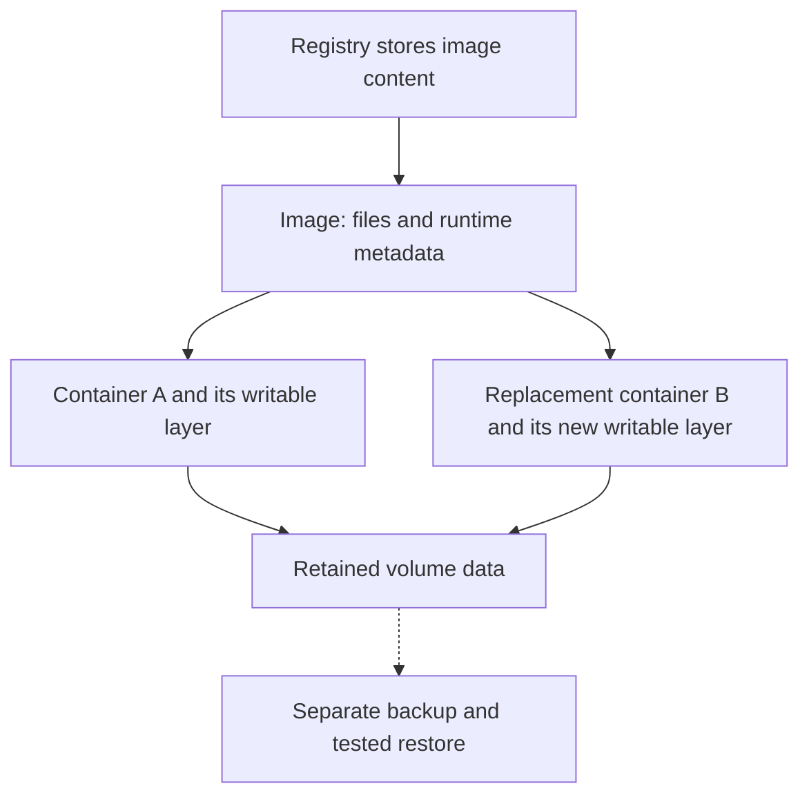
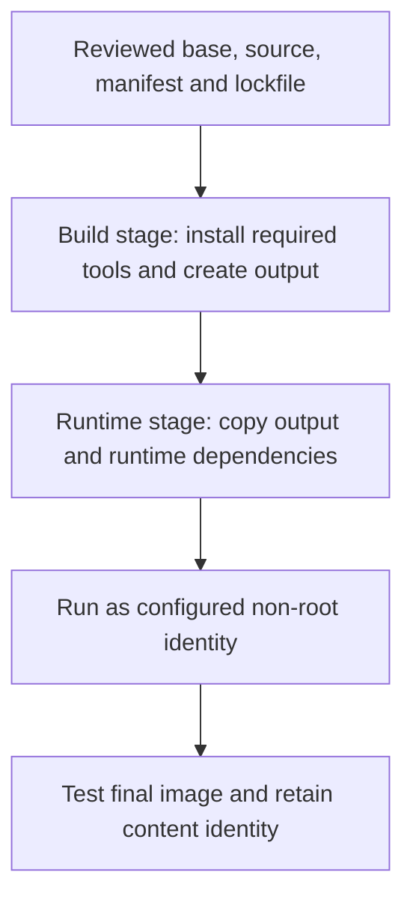
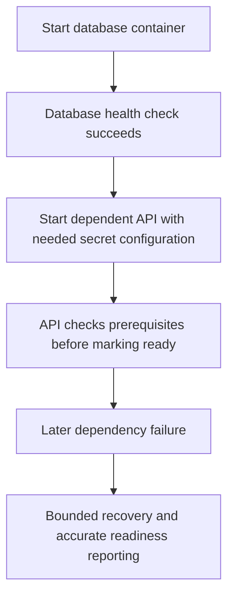
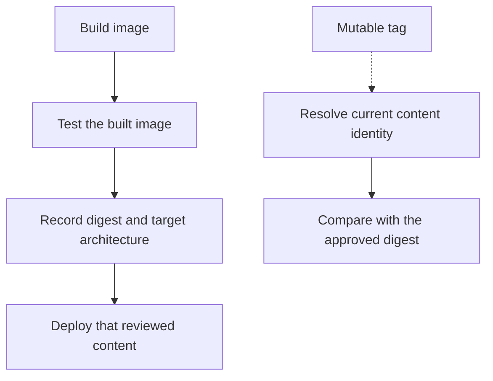
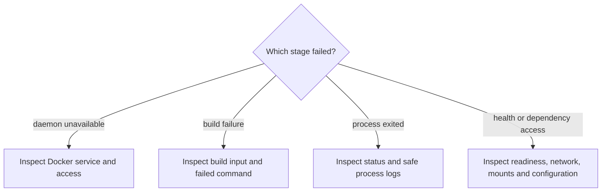

# Docker and containerization

<span class="notes-section-label">**Section 3 reading path:**</span> Package the service you have already tested with PostgreSQL. Learn the image/container concepts, build one image, then check Compose networking and shutdown. Use the linked lab for comparison. Change its COPY paths to include your application modules and static UI; do not replace your application with its small example server. A NestJS image needs compiled files and runtime dependencies. Kubernetes and deployment across several instances are later extensions.

For unfamiliar technical terms, use the [Section 3 vocabulary guide](./index.md#section-3-vocabulary).

Use the [canonical Node/PostgreSQL container lab](../container-deployment-lab.md) for the runnable implementation. This chapter explains its decisions and troubleshooting in five questions. Docker commands use the Compose plugin (`docker compose`); the lab records its own tested Engine/Compose/image versions. Its previous live-container evidence is historical, not a new run from reading this page.

<!-- tech-check: t23-q01; level: 3 -->

## What are images, containers, volumes and registries?

*Study depth: Foundational*

Level Up: L1 — Junior\
Tech Check level: ⭐⭐⭐

Source mapping: [R060](./requirements.md#r060).


<div class="notes-core-answer">

<p class="notes-core-answer__title">Core answer</p>

An image packages application files, dependencies and information about how to run them. A container is a running or stopped instance of an image, with its own writable layer. A registry stores and distributes images.

**A volume keeps data outside a container's replaceable writable layer.** Replacing a container does not have to remove that volume's data. **A container is not a separate virtual machine, and a volume is not a backup.** Plan and test backup recovery separately.

</div>

<span class="notes-section-label">**Separate image, container and durable storage**</span>

A replacement container can attach retained data. A separate recovery plan is still needed for lost or damaged data.




:::: details Deeper explanation and additional examples

The Docker CLI sends commands to a background service called the daemon. The daemon builds or downloads images and manages containers, networks and volumes. On macOS, Linux containers run inside a Linux VM. They share that VM’s kernel rather than getting a separate kernel each. Access to the daemon is powerful: mounting its Docker socket into an untrusted application gives that application control over the Docker environment.

An image contains layers. A container adds a layer where it can write files. Replacing the container loses files saved only in that layer. Store important database files in a named volume or managed database, and test backups separately. A bind mount connects a host directory to a container directory; it can hide files originally packaged at that path. Docker manages named volumes, but does not automatically copy them to other hosts.

Give each container one main service responsibility so its health, logs and scaling are easy to manage. This does not mean it must have exactly one OS process; a controlled child process or small init process may be needed. Choose a VM when you need a separate kernel or OS. Choose a managed service when the provider can take responsibility for running the database or hosts.

::::

<span class="notes-section-label">**Practice and acceptance**</span>

Draw which data survives process restart, container replacement, volume deletion and host loss. In an owned lab, persist a counter across replacement and recover from a separate backup. Accept only when volume persistence and backup restoration are demonstrated separately. References: [Docker overview](https://docs.docker.com/get-started/docker-overview/), [volumes](https://docs.docker.com/engine/storage/volumes/).

---

<!-- tech-check: t23-q02; level: 3 -->

## How do you build a small, reproducible Node image?

*Study depth: Intermediate*

Level Up: L3 — Senior\
Tech Check level: ⭐⭐⭐

Source mapping: [R061](./requirements.md#r061), [R103](./requirements.md#r103), [R178](./requirements.md#r178).


<div class="notes-core-answer">

<p class="notes-core-answer__title">Core answer</p>

Start from a reviewed base image, send only the needed files to the build, and install dependencies from the lockfile. **Keep build tools separate from the files needed to run the application.** Run the service as a non-root user with the permissions it actually needs.

These choices make the image smaller and easier to reproduce and inspect. **A pinned, reproducible image still needs security updates and retesting.** Rebuilding the same old content forever also preserves its old vulnerabilities.

</div>

<span class="notes-section-label">**Keep build tools out of the runtime stage**</span>

The final image needs the application output and runtime dependencies, rather than every tool used to produce them.




:::: details Deeper explanation and additional examples

The canonical Dockerfile below is included directly from the lab. Its selected plain-JavaScript server needs no compilation; a TypeScript application needs a build stage with development dependencies and a tested runtime output. Do not invent an empty build just to imitate that pipeline.

<<< ../../workbench/node-js/deployment/container-lab/Dockerfile

Copy `package.json` and the lockfile before the source so Docker can reuse the dependency layer after a source-only change. `npm ci` follows the lockfile and rejects a mismatch. `--omit=dev` leaves out development dependencies. `--ignore-scripts` is appropriate for this reviewed lab, but can break packages that need installation scripts. Native modules must match the runtime ABI, CPU architecture and C library. Do not copy macOS `node_modules` into a Linux image.

Use `.dockerignore` to exclude `.git`, local `node_modules`, credentials and files the image does not need. COPY only the intended paths. A secret copied into one layer can remain there even if a later layer deletes it. For private package access, use a reviewed BuildKit secret mount. Supply application credentials at runtime. Do not bake either kind of secret into a public image with `ARG` or `ENV`.

Exec-form `CMD ["node", "server.mjs"]` sends the stop signal directly to Node. A writable volume must allow access by the application’s user/group IDs (UID/GID). Setting `USER` does not change existing file ownership. A read-only root filesystem works when the application has explicit writable paths for temporary files and data. Fix permission errors narrowly rather than using privileged mode or `chmod 777`.

::::

<span class="notes-section-label">**Practice and acceptance**</span>

Build the owned canonical lab, inspect runtime UID and files, then rebuild after a source-only change and explain cache reuse. Accept when no secret/test/host dependency tree is packaged, required runtime files work under non-root and a deliberate base update triggers retesting. Reference: [Docker build practices](https://docs.docker.com/build/building/best-practices/), [build secrets](https://docs.docker.com/build/building/secrets/).

---

<!-- tech-check: t23-q03; level: 3 -->

## How do Compose networking, readiness and secrets fit together?

*Study depth: Intermediate*

Level Up: L3 — Senior\
Tech Check level: ⭐⭐⭐

Source mapping: [R061](./requirements.md#r061), [R178](./requirements.md#r178).


<div class="notes-core-answer">

<p class="notes-core-answer__title">Core answer</p>

Compose describes a local application made of several containers. It configures how services find each other by name, which ports are published, which files are mounted and which dependencies start first. Supply secrets only to the services that need them.

**A started container is not necessarily a ready dependency.** A database process may be running before it can handle the application's queries. Initial health-based startup ordering helps, but the application must still handle later connection failures, reconnect when appropriate and report readiness accurately.

</div>

<span class="notes-section-label">**Wait for readiness, then keep handling failures**</span>

Startup ordering is only the initial transition. Later database outages still need an application policy.




:::: details Deeper explanation and additional examples

<<< ../../workbench/node-js/deployment/container-lab/compose.yaml

From inside `api`, connect to database hostname `db` on container port 5432. `localhost` would mean the API container itself. The host’s temporary loopback port maps to API port 3000; containers do not use that host port to reach the database. `EXPOSE` only documents a port. Listen on `0.0.0.0` inside the container and separately restrict which host addresses publish it.

The lab has separate database and edge networks. It does not publish a database port on the host. The API’s edge network allows outgoing traffic, so it is not a setup that blocks all outbound connections. Use service names instead of temporary container IP addresses. Handle reconnection after a container is replaced.

`depends_on: condition: service_healthy` waits for the database’s health check during initial startup. The application must still check connectivity and schema, handle later failures and become unready during shutdown. A database can accept connections before its required migration has run. Docker health status alone does not guarantee restart, failover or removal from traffic in every platform.

Mount secrets only in services that need them. Local Compose secret files are still files on the host; they are not an encrypted managed vault. The lab separates database-administrator credentials from normal application credentials. PostgreSQL does not repeat its initialization scripts for an existing volume when a secret file changes. Change the actual database role’s password and update the schema through deliberate operations.

::::

<span class="notes-section-label">**Practice and acceptance**</span>

Use the lab's owned-copy setup, then `docker compose -p "$lab_project" config --quiet` and its documented startup commands. Test DNS, hidden database port, correct secret mounts, delayed startup and database interruption/recovery. Accept with bounded readiness failure while liveness remains meaningful, followed by graceful shutdown. References: [Compose startup order](https://docs.docker.com/compose/how-tos/startup-order/), [networking](https://docs.docker.com/compose/how-tos/networking/), [Compose secrets](https://docs.docker.com/compose/how-tos/use-secrets/).

---

<!-- tech-check: t23-q04; level: 3 -->

## How do tags, digests and orchestration affect delivery?

*Study depth: Advanced*

Level Up: L4 — Lead\
Tech Check level: ⭐⭐⭐

Source mapping: [R098](./requirements.md#r098), [R103](./requirements.md#r103).


<div class="notes-core-answer">

<p class="notes-core-answer__title">Core answer</p>

**A tag is a name that can point to different image content later.** A digest identifies fixed content, such as a platform image or a multi-platform image index. Build and test one image, record its digest and target architecture, then deploy that reviewed content.

**A digest proves which content you selected, not that it is safe or suitable.** An orchestrator manages running instances and rollouts, but you still need correct health checks, resource limits, state management and shutdown rules.

</div>

<span class="notes-section-label">**Deploy the reviewed content identity**</span>

A tag is a convenient name. The retained digest and architecture identify the content that was actually tested.




:::: details Deeper explanation and additional examples

A multi-platform image index can identify several platform-specific images. A local image ID identifies something different. Record the source revision, lockfile, base reference, target platform, test result and release digest. The tag `latest` does not tell you what ran yesterday. Update pinned images through the normal checks; keeping an old digest forever also keeps its old vulnerabilities.

A registry hosts image repositories. Authentication authorizes pull/push to selected namespaces and should use short-lived scoped credentials where supported. Use a credential helper or protected stdin flow rather than a literal password in shell history/logs. Reading an image does not authorize publishing a replacement. This course prepares release evidence locally; registry publication is a separate controlled delivery action.

Compose is useful for local development and integration on one host. ECS or Kubernetes can schedule application copies, replace failed ones and control rollouts. You still need to configure resource limits, health checks, shutdown, secrets, routing and diagnostics. An orchestrator does not remove the need for duplicate protection, database connection budgets or compatible migrations. Kubernetes is an optional extension; AWS ECS is the main cloud path here.

::::

<span class="notes-section-label">**Practice and acceptance**</span>

Resolve an owned test image to its digest, inspect its platform and prepare a release record showing a tag can move while the old digest remains identifiable. Design a two-replica rollout with drain and rollback. Accept with explicit registry permission and platform checks; do not push as part of this notes task. References: [Docker image digests](https://docs.docker.com/dhi/core-concepts/digests/), [multi-platform builds](https://docs.docker.com/build/building/multi-platform/), [ECS services](https://docs.aws.amazon.com/AmazonECS/latest/developerguide/ecs_services.html).

---

<!-- tech-check: t23-q05; level: 3 -->

## How do you troubleshoot a container that will not work?

*Study depth: Intermediate*

Level Up: L3 — Senior\
Tech Check level: ⭐⭐⭐

Source mapping: [R060](./requirements.md#r060).


<div class="notes-core-answer">

<p class="notes-core-answer__title">Core answer</p>

**Find the stage that failed before changing the setup.** Is Docker's daemon unavailable, did the image build fail, did the process exit, did a health check fail, or can the service not reach a file or dependency?

Inspect the relevant status, logs, network settings, file ownership and runtime configuration. **Do not randomly rebuild or grant broad privileges to hide the symptom.** Use narrowly targeted commands against your own project and make the smallest change supported by the evidence.

</div>

<span class="notes-section-label">**Narrow the failing container stage**</span>

Inspect the next failed boundary instead of changing privileges or rebuilding blindly.




:::: details Deeper explanation and additional examples

| Symptom | First evidence | Typical next decision |
|---|---|---|
| Cannot connect to daemon | Selected Docker context and daemon status | Start/connect to the intended environment |
| Build fails at `npm ci` | Lock consistency, registry and failing package step | Fix manifest/lock or reviewed build dependency |
| Exec format error | Image OS/architecture | Build/pull the matching platform |
| Container exits immediately | Exit code, entrypoint and sanitized logs | Fix runtime command/config/dependency |
| Host cannot reach API | Container listener, published mapping, health | Distinguish loopback listener from host binding |
| API cannot reach DB | Service DNS/network, container port, credentials | Test the exact dependency boundary |
| Permission denied | Runtime UID, file ownership, mount and read-only paths | Grant the narrow required access |

```sh
# Only in your owned lab; inspect may reveal environment/configuration secrets.
docker compose -p "$lab_project" ps
docker compose -p "$lab_project" logs --tail=100 api
docker compose -p "$lab_project" port api 3000
docker compose -p "$lab_project" exec api id
docker compose -p "$lab_project" exec api node -e "fetch('http://127.0.0.1:3000/healthz').then(r=>console.log(r.status))"
```

Use `docker inspect` to check state, health, mounts and network membership. Avoid sharing full environment output because it can contain secrets. `exec` needs a running container; for a crashing process, use a temporary debug command in your own copy. Small or distroless images may have no shell or curl. Use the available runtime tools or an approved debug container instead of changing a live production container.

Capture the first error before automatic restarts hide it. An OOM-killed flag suggests the process ran out of memory. Exit 137 can also mean another cause of SIGKILL, so check actual memory use and limits. For a failed health check, inspect its output and deadline before simply increasing a delay.

::::

<span class="notes-section-label">**Practice and acceptance**</span>

Inject three separate failures in an owned copy: wrong database hostname, wrong file ownership and invalid startup command. Recover each using evidence, record the smallest fix and prove no change to other containers. Remove only the lab's containers/networks/volume/image after collecting results; volume deletion is destructive. References: [Compose logs](https://docs.docker.com/reference/cli/docker/compose/logs/), [container inspect](https://docs.docker.com/reference/cli/docker/container/inspect/), [Docker troubleshooting](https://docs.docker.com/config/daemon/troubleshoot/).

## Revision and practical checkpoint

Follow the complete path: source/build context → image layers → release digest → process user → listener/network → dependency → shutdown → data recovery. The linked lab provides the implementation.

### Mixed practice

1. The API connects to localhost:5432 inside its container while PostgreSQL is a separate Compose service. What changes?
2. A database password file changes, but the persistent database keeps rejecting it. Why?

<span class="notes-section-label">**Answer guide — read after attempting both cases**</span>

1. Use the database service DNS name and its container port on the shared network. Publishing another host port is unnecessary for service-to-service traffic.
2. A changed bootstrap file does not rotate an initialized database role. Coordinate actual role credential rotation, application secret adoption and pool restart/reconnect without deleting the authoritative volume.
