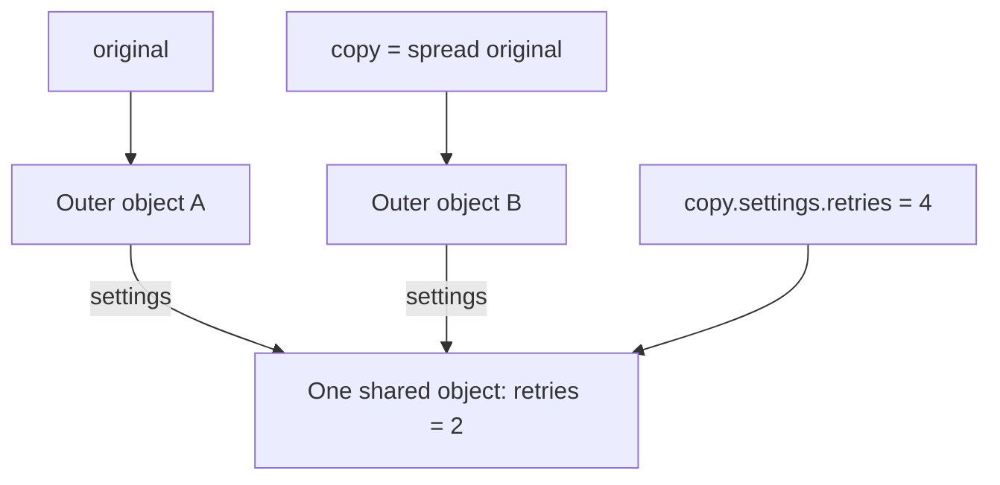
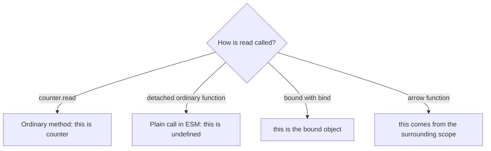
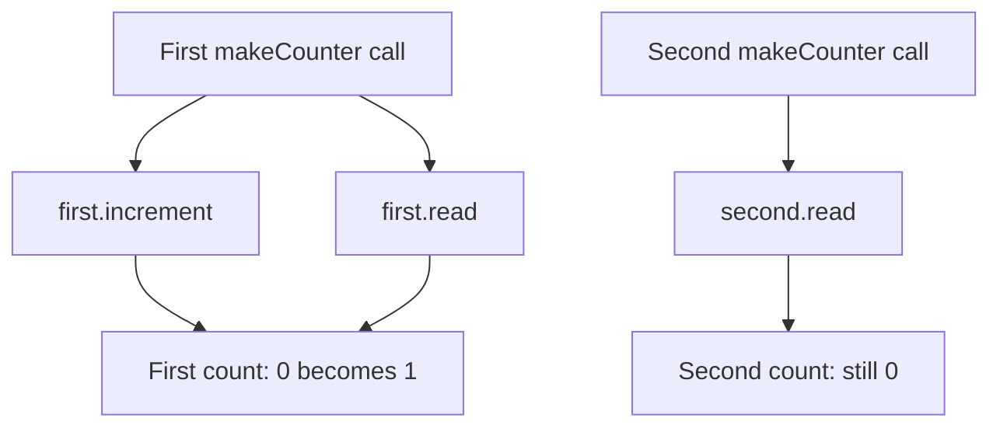

# Core JavaScript

Objects, function calls and lexical scope explain how JavaScript code shares data in Node.js.

<!-- tech-check: t26-q01; level: 1 -->

## How do object references affect assignment and copying?

*Study depth: Foundational*

Level Up: L1 — Junior\
Tech Check level: ⭐

Source mapping: [R148](./requirements.md#r148).


<div class="notes-core-answer">

<p class="notes-core-answer__title">Core answer</p>

**Assigning an object to another variable does not copy it.** Both variables point to the same object, so a change through one variable is visible through the other.

Object spread, such as `{ ...original }`, creates a new outer object. It copies the object's own enumerable properties: roughly, the properties included when JavaScript lists that object's own values. **Nested objects are still shared** unless you copy them too.

</div>

<span class="notes-section-label">**Picture the references**</span>

Arrows mean “points to”. Spreading creates a second outer object, but both objects still reach the same nested settings.




:::: details Deeper explanation and additional examples

```js
const original = { settings: { retries: 2 } };
const copy = { ...original };
copy.settings.retries = 4;
console.log(original === copy, original.settings.retries);
```

The output is `false 4`. The outer objects have different identities and both `settings` properties point to the same object. To update that branch independently, copy it too: `{ ...original, settings: { ...original.settings } }`.

::::

---

<!-- tech-check: t26-q02; level: 1 -->

## What determines the value of this in a function?

*Study depth: Foundational*

Level Up: L1 — Junior\
Tech Check level: ⭐

Source mapping: [R149](./requirements.md#r149).


<div class="notes-core-answer">

<p class="notes-core-answer__title">Core answer</p>

For an ordinary method call such as `counter.read()`, **`this` is the object before the dot**: here, `counter`. If you store the method in another variable and call it on its own, it loses that connection. Use `bind()` or a wrapper function when you need to preserve it.

**An arrow function uses `this` from the surrounding code**, rather than choosing it from the way the arrow is called.

</div>

<span class="notes-section-label">**Follow the call**</span>

Read each branch as a separate way of calling the function. The detached-call result below assumes an ES module.




:::: details Deeper explanation and additional examples

```js
const counter = {
  value: 3,
  read() { return this.value; }
};
const read = counter.read.bind(counter);
console.log(read());
```

Save as an ES module. The bound call prints `3`. Calling a detached `counter.read` without binding it gives the method `undefined` as its receiver in this module, and reading `this.value` throws. Use a bound callback or a wrapper such as `() => counter.read()` when passing the method to another API.

::::

---

<!-- tech-check: t26-q03; level: 1 -->

## What does a closure capture, and when do two closures share state?

*Study depth: Foundational*

Level Up: L1 — Junior\
Tech Check level: ⭐

Source mapping: [R150](./requirements.md#r150).


<div class="notes-core-answer">

<p class="notes-core-answer__title">Core answer</p>

A closure is a function that can still access variables from the place where it was created, even after the outer function has finished. **It remembers access to the variables, not just a copy of their values.**

Functions created during the same outer call can share a variable. **Each new call to the outer function creates separate local variables.** For example, two calls to `makeCounter()` can create two independent counters.

</div>

<span class="notes-section-label">**Picture the captured variables**</span>

The two functions from one call share one count. A second call creates a different count.




:::: details Deeper explanation and additional examples

```js
function makeCounter() {
  let count = 0;
  return {
    increment: () => ++count,
    read: () => count
  };
}

const first = makeCounter();
const second = makeCounter();
first.increment();
console.log(first.read(), second.read());
```

The output is `1 0`. Both functions returned by the first call see the same `count` binding, so `read` sees the increment. The second call creates a separate binding. A callback that closes over a large object can keep it reachable while the callback is registered, so release subscriptions when their work ends.

[Homework on closures, races and cleanup](../../practice/frontend/f03-javascript.md).

::::

## Revision

Try each question without opening its answer. Explain the reason, not just the term; then expand **Show answer** to check. Diagram questions link back to the visual so you can trace its parts and arrows.

<!-- revision-covers: t26-q01 -->

<span class="notes-section-label">**1. Predict and explain diagram — In the [reference diagram](#t26-q01), copy is made with object spread. Why does changing copy.settings.retries also change original.settings.retries, while original === copy is false?**</span>

::: details Show answer

The spread creates a **different outer object**, so the identity comparison is false. Both settings properties still point to the same nested object, so editing retries through either path changes that shared object. Copy the nested branch too when it needs independent ownership.

[Revisit the explanation and examples](#t26-q01).

:::


---

<!-- revision-covers: t26-q02 -->

<span class="notes-section-label">**2. Compare — In an ES module, how do counter.read(), a detached ordinary read(), and an arrow function choose this? What does bind preserve?**</span>

::: details Show answer

The ordinary method call uses counter as its receiver. A detached plain call has undefined as this in an ES module; it has lost the object-before-the-dot connection. A bound function keeps its specified receiver, while an arrow keeps this from the surrounding scope.

[Revisit the explanation and examples](#t26-q02).

:::


---

<!-- revision-covers: t26-q03 -->

<span class="notes-section-label">**3. Predict and explain diagram — Two calls to makeCounter create first and second. After first.increment(), why does first.read() return 1 while second.read() returns 0?**</span>

::: details Show answer

The two functions returned by the first call reach **one shared count binding**, so its reader sees the increment. The second outer call created a separate count binding. Closures preserve access to variables, not a shared global counter or a frozen copy of the initial value.

[Revisit the explanation and examples](#t26-q03).

:::
