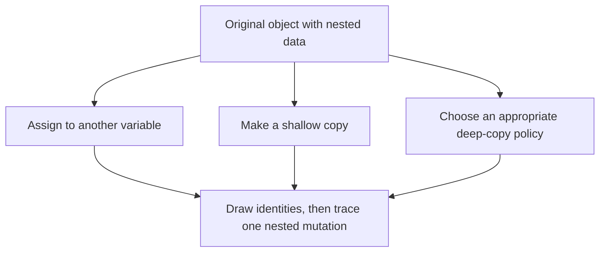
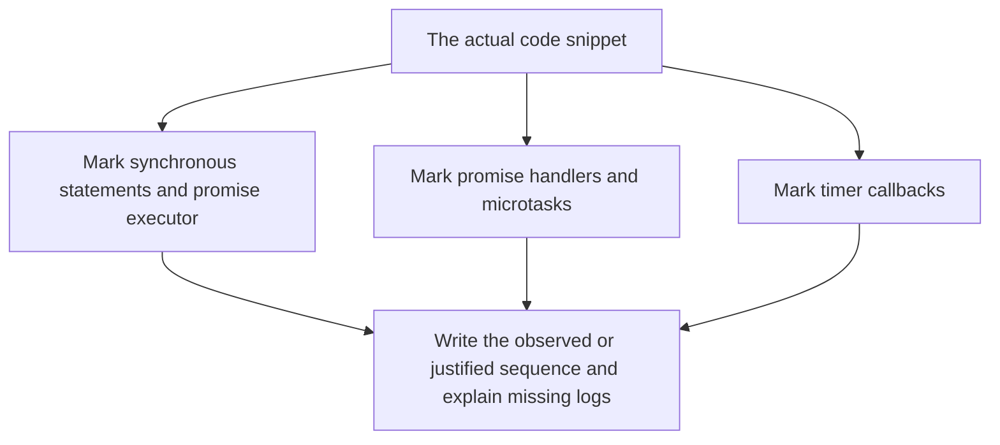
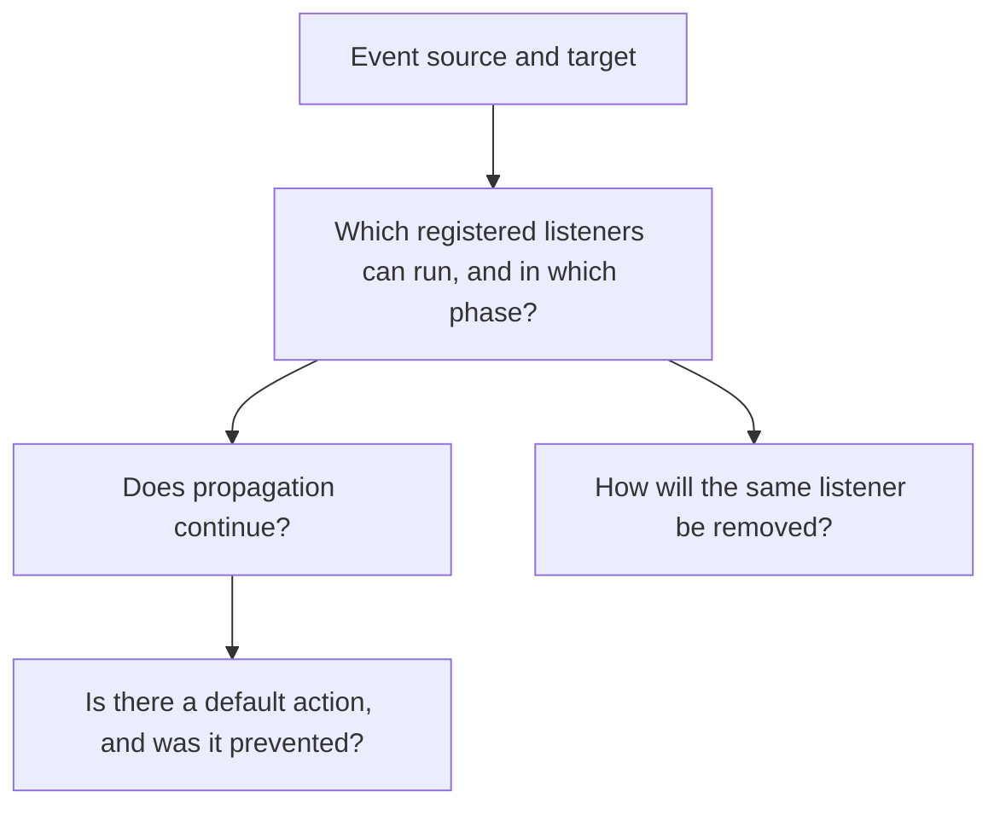

# JavaScript tech-check

Use these interview questions to practise explaining JavaScript in your own words. This page lists questions, not model answers. Some code questions refer to snippets that are missing from the transcript; use the original snippet if you have it, rather than guessing its output.

## Data types

- Which data types does JavaScript have? How many are there?

- How do primitive values, such as numbers and strings, differ from objects?

- Besides how variables refer to them, how do these values differ? For example, can you change the value itself?

- What does it mean for a variable to hold a reference to an object? Explain what happens when two variables refer to the same object.

- If objects are stored in heap memory, what can you say about where primitive values are stored?

## Symbols

- What is Symbol, and how do you create one?

- When would you use Symbol() versus Symbol.for()?

- When is it useful to retrieve and reuse the same symbol from the global symbol registry?

- Can you retrieve a symbol's description or its global registry key? How do those differ?

  *The original question is unclear. The speakers discuss `Symbol.keyFor()`, but the example shown on screen is missing from the transcript.*

## Variables, scope, and hoisting

- What are the differences between var, let, and const?

- Which kinds of scope determine where a variable can be used in JavaScript?

- What is hoisting?

- Does hoisting apply to let and const, or only to var?

- When does JavaScript identify variable and function declarations, relative to running the code?

- Code exercise: A `var` declaration and a function declaration use the same name. What does the supplied code print, and why?

**Sketch the references while practising**

Use these branches to draw your own answer. Which objects and nested objects should share identity in each case?

## Object copying

- How can you make a copy of the supplied object?

- What is the difference between a shallow copy and a deep copy?

- Which methods can you use to make a deep copy, including nested objects?

- When does `JSON.parse(JSON.stringify(obj))` work as a copying method, and which values or behaviors does it fail to preserve?

- What happens when the object contains getters and setters?

- Does `{ ...obj }` preserve settings such as whether a property can be written or reconfigured?

  *The speakers say “destructuring,” but they appear to mean copying with object spread.*

## Property descriptors and object restrictions

- What settings describe an object property? Explain the flags in its property descriptor.

- Have you used property descriptors in practice?

- Which methods on `Object` change property-descriptor flags as part of their work?

  *The interviewer gives `Object.freeze()` as a hint. The answer also discusses `Object.seal()`.*

## Object iteration and collections

- How can you go through an object's properties one by one?

- Can you use for...of with an ordinary object?

- Compare Map and Object. When would you choose each?

- How would you find the number of entries in an object and in a `Map`?

- Can you list or loop over the entries in a `WeakMap`?

  *The candidate also explains weak references and garbage collection. The transcript does not clearly show a separate question about them.*

## Getters and setters — coding exercise

- Given an object with name and surname, implement:
    - A `fullName` getter that combines `name` and `surname` without storing a separate full-name value.
    - A `fullName` setter that splits the supplied full name and updates `name` and `surname`.

- How does JavaScript distinguish a getter from an ordinary method?

- Can you use destructuring to replace the setter's separate assignments with one line?

## Arrays

- What ways do you know to create an array?

- Code exercise: What does the supplied Array.from() call return? How many elements does it produce?

- Which array methods change the original array, and which leave it unchanged?

- Code exercise: What does the supplied snippet involving push() and splice() print?

- What changes if the second argument to splice() is changed?

- Code exercise: In what order does the supplied numeric array sort when no comparison function is passed?

- Code exercise: What happens to an array and its `length` when you assign a value at an index far beyond its current end?

- Can you assign directly to an array’s length? Does it throw an error?

- What happens to the elements when you shorten length?

- How can you check whether a value is an array?

## Functions and this

- What kinds of functions do you know in JavaScript?

- When would you use an IIFE: a function expression that is called immediately after it is created?

- What are the differences between ordinary functions and arrow functions?

- How can you call a function with a chosen `this` value?

- Can call(), apply(), or bind() change an arrow function’s this?

## Asynchronous JavaScript and promises

- What is asynchronous JavaScript?

- What states can a promise have?

- Code exercise: Predict the output order of the supplied code. Explain its synchronous logs, timers, promise executor, rejection and chained handlers.

- Which queue runs promise handlers: the microtask queue or a task queue?

  *The speaker asks whether “the promise” is a microtask or macrotask. Here, the question refers to its scheduled handlers; the promise object itself is not a queued task.*

- Why do the logs labelled 4 and 5 not appear in that snippet?

- Besides `then()` and `catch()`, which method can you use to run cleanup after a promise settles?

- Does setTimeout(callback, 10) guarantee that the callback executes in exactly 10 milliseconds?

- Compare Promise.all() and Promise.allSettled().

- Compare Promise.any() and Promise.race().

**Trace scheduling before predicting output**

Use the actual supplied snippet. First separate these categories, then explain the ordering guaranteed by its execution context.

## async/`await` and error handling

- Explain async/`await` and how it works.

- How do you handle errors when using async/`await`?

- Which errors can escape a `try...catch` around code that starts asynchronous work?

  *The example is an exception thrown later, when a timer callback runs.*

## Browser APIs

- Which browser APIs provide information or features such as device memory, Bluetooth or location?

  *The discussion includes `window`, `navigator`, `location`, `history` and `screen`.*

## DOM events

- How can you attach a function to handle a DOM event?

- How do `onclick` and `addEventListener()` differ, and what mistakes should you watch for?

- By default, does an event listener run during the capture phase or the bubble phase?

- What other options can you pass to addEventListener()?

- How can you remove an event listener?

- What arguments must you supply to removeEventListener()?

- What default browser action can `preventDefault()` stop?

- How can you stop an event from continuing through the DOM event path?

- Can you create your own event?

  *The exercise asks you to create a `CustomEvent`, supply options and data, attach a listener and dispatch the event.*

**Draw an event path for your example**

Mark the listener target, its options, removal and the default browser action. Fill in the behavior from the event example you are explaining.

## Cookies

- What are cookies, why are they needed, and how are they used?

- Which cookie attributes do you know, and what does each control?

- If a cookie is set over HTTPS without the Secure attribute, can it also be sent over HTTP?

- What does the SameSite attribute do?

- How do you create a cookie that has no persistent expiry date, often called a session cookie?

  *The candidate asks to skip the session-cookie question.*

## Web Storage

- Could `localStorage` replace the cookie in this example? Explain the differences that matter for this use.

- What is localStorage used for?

- If you copy a URL into a new tab and close the original tab, what happens to its sessionStorage data?

- How could you keep that information available when moving to the new tab?

An audience member asks whether L2 covers the same topics. The speaker says:
- The topic areas are broadly the same.
- L2 focuses on basic and intermediate understanding.
- Advanced details are usually unnecessary unless the candidate chooses to discuss them.
- The same topic can be explored at different levels of detail.
