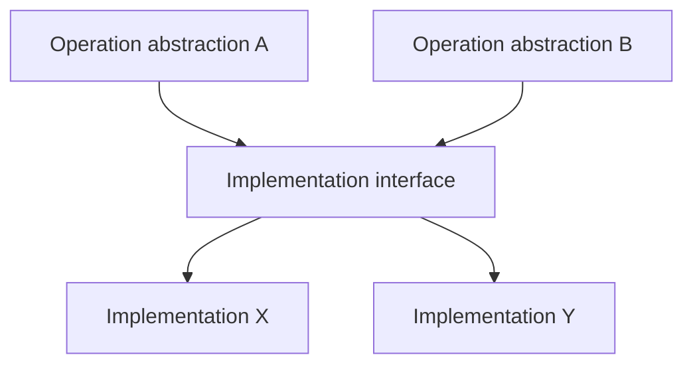
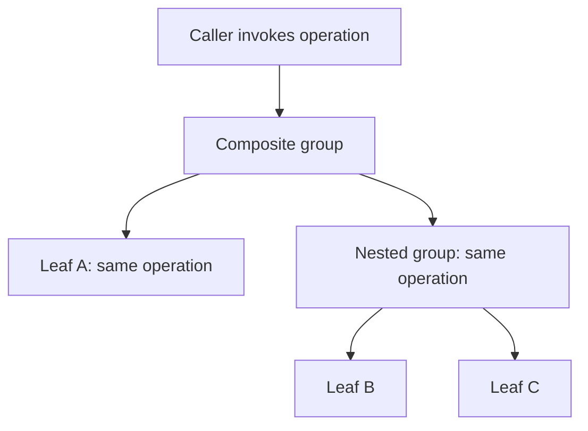
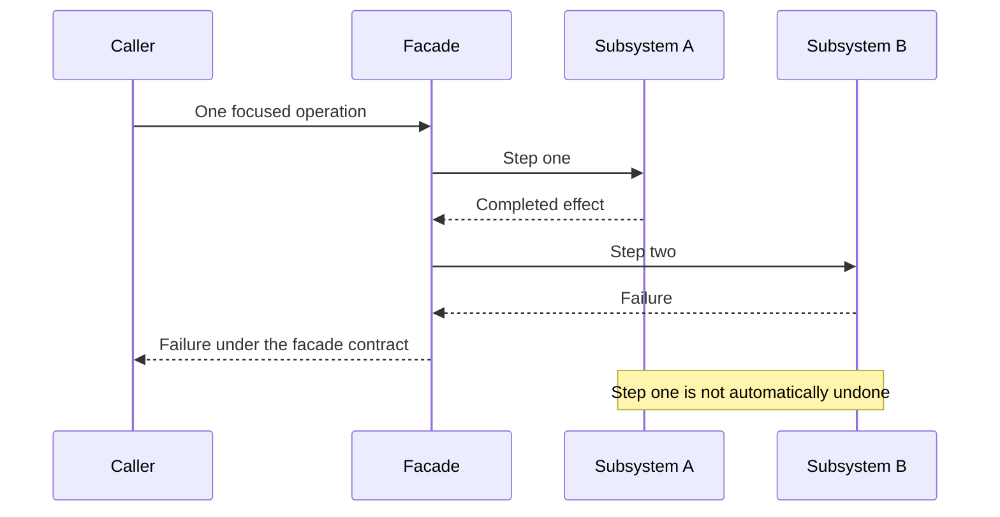
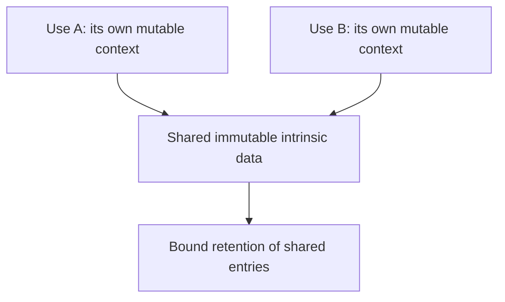
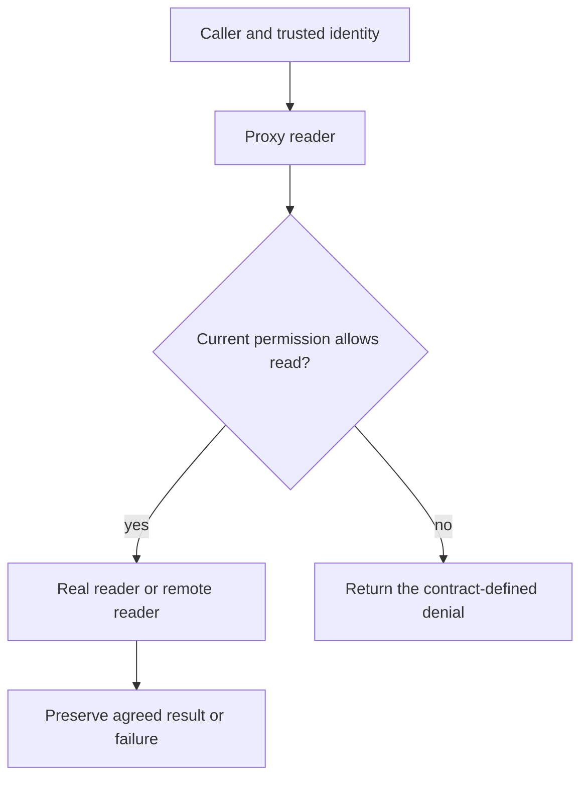

# Structural patterns

Bridge, Composite, Facade, Flyweight and Proxy complete the structural family. [Adapter and Decorator](../18-patterns.md#t18-q03) already have the shared worked reader-contract lesson; reuse it rather than duplicate its implementation.

Examples are standalone `.mjs` files for Node.js 24.18.0, using built-in modules only. Keep experiments in an owned lab. [Pattern overview](../18-patterns.md) supplies selection criteria; exercises remain your separate practice.

---

<!-- tech-check: t18-q10; level: 2 -->

### How does Bridge let two dimensions of a design vary independently?

*Study depth: Intermediate*

Level Up: L2 — Software Engineer\
Tech Check level: ⭐⭐

Source mapping: [R063](../requirements.md#r063), [R163](../requirements.md#r163).


<div class="notes-core-answer">

<p class="notes-core-answer__title">Core answer</p>

Bridge separates two aspects of a design that need to change independently. One side exposes the operation the caller uses; the other supplies how that operation is carried out. **Connect the two sides instead of creating a subclass for every possible combination.**

An Adapter makes an existing interface compatible with another interface. Bridge is chosen to let both sides evolve independently from the start, rather than mainly to repair an incompatibility.

</div>

<span class="notes-section-label">**Connect the two independent dimensions**</span>

The abstraction delegates to a selected implementation instead of requiring a subclass for every pair.




:::: details Deeper explanation and additional examples

<span class="notes-section-label">**Why and when**</span>

Report content can vary between brief/detail while encoding varies between JSON/text. Four combinations need not mean four named subclasses. Report abstractions depend on an encoder contract, not a particular encoding class.

<span class="notes-section-label">**Worked example — predict before running**</span>

```js
// file: bridge.mjs
import assert from 'node:assert/strict';
class Report {
  constructor(encoder) {
    if (typeof encoder?.encode !== 'function') throw new TypeError('Encoder');
    this.encoder = encoder;
  }
  content() {
    throw new Error('Content required');
  }
  output(items) {
    if (
      !Array.isArray(items) ||
      items.length > 10 ||
      Array.from(items).some((x) => typeof x !== 'string' || x.length > 80)
    )
      throw new TypeError('Items');
    const text = this.encoder.encode(this.content([...items]));
    if (typeof text !== 'string' || text.length > 2000) throw new TypeError('Output');
    return text;
  }
}
class Brief extends Report {
  content(items) {
    return { count: items.length };
  }
}
class Detail extends Report {
  content(items) {
    return { items };
  }
}
const json = { encode: JSON.stringify };
const text = {
  encode: (value) =>
    Object.entries(value)
      .map(([k, v]) => `${k}=${JSON.stringify(v)}`)
      .join(';'),
};
assert.equal(new Brief(json).output(['Book']), '{"count":1}');
assert.equal(new Brief(text).output(['Book']), 'count=1');
assert.equal(new Detail(json).output(['Book']), '{"items":["Book"]}');
assert.equal(new Detail(text).output(['Book']), 'items=["Book"]');
assert.throws(() => new Brief({}), TypeError);
assert.throws(() => new Brief({ encode: () => null }).output([]), TypeError);
```

The two report classes and two implementation objects produce all four combinations. Some code also resembles a template workflow; pattern roles can overlap. The Bridge intent here is independent content and encoding evolution, not merely the presence of inheritance.

::::

<span class="notes-section-label">**Mistakes, alternatives and debugging**</span>

Extracting a Bridge for one stable combination adds wiring without useful variation. Check which axis changed before adding another subclass. For small requirements, two composed functions may be clearer than the class representation.

<span class="notes-section-label">**Examiner follow-up**</span>

Can a Bridge be introduced during refactoring? Yes; the distinction from Adapter is intent and responsibility, not a required point in the project timeline.

::: tip Key takeaway
Bridge separates an abstraction from its implementation so both can evolve independently.
:::

<span class="notes-section-label">**Practice — learner work still required**</span>

- [ ] Add a third encoder without editing Brief/Detail, then another report abstraction without editing encoders. Acceptance: shared output/error tests and a reasoned comparison with four concrete combined classes.

<span class="notes-section-label">**Official implementation reference**</span>

[Documentation](https://nodejs.org/download/release/v24.18.0/docs/api/assert.html). References explain runtime mechanics; the design choices and bounded contracts are the teaching examples above.

---

<!-- tech-check: t18-q11; level: 2 -->

### How does Composite give leaves and groups one usable contract?

*Study depth: Intermediate*

Level Up: L2 — Software Engineer\
Tech Check level: ⭐⭐

Source mapping: [R063](../requirements.md#r063), [R163](../requirements.md#r163).


<div class="notes-core-answer">

<p class="notes-core-answer__title">Core answer</p>

Composite represents individual items and groups as a tree. Both provide the same operation, so a caller can use a group much as it uses one item. A group applies the operation to its children and combines their results as defined by the application.

**A common interface does not make every tree safe to process.** Limit depth and size, detect or prevent cycles, and decide who may change the children. Also define how group operations combine results and handle failures.

</div>

<span class="notes-section-label">**Use one operation across a tree**</span>

A group delegates to children through the same contract. The traversal still needs depth, size and cycle rules.




:::: details Deeper explanation and additional examples

<span class="notes-section-label">**Why and when**</span>

A product bundle can contain products and nested bundles. A caller asks for the same price operation without branching on every shape. This owned immutable tree is deliberately smaller than an arbitrary external graph.

<span class="notes-section-label">**Worked example — predict before running**</span>

```js
// file: composite.mjs
import assert from 'node:assert/strict';
class Product {
  constructor(cents) {
    if (!Number.isSafeInteger(cents) || cents < 0 || cents > 10000)
      throw new RangeError('Price');
    this.cents = cents;
    Object.freeze(this);
  }
  price() {
    return total(this);
  }
}
class Bundle {
  constructor(children) {
    if (
      !Array.isArray(children) ||
      children.length > 10 ||
      Array.from(children).some((c) => !(c instanceof Product || c instanceof Bundle))
    )
      throw new TypeError('Children');
    this.children = Object.freeze([...children]);
    Object.freeze(this);
  }
  price() {
    return total(this);
  }
}
function total(root) {
  let remaining = 100;
  function visit(node, depth) {
    if (--remaining < 0 || depth > 8) throw new RangeError('Tree budget');
    return node instanceof Product
      ? node.cents
      : node.children.reduce((n, c) => n + visit(c, depth + 1), 0);
  }
  return visit(root, 0);
}
const book = new Product(500),
  pen = new Product(100);
const children = [book, new Bundle([pen, pen])];
const basket = new Bundle(children);
children.length = 0;
assert.equal(book.price(), 500);
assert.equal(basket.price(), 700);
assert.equal(new Bundle([]).price(), 0);
assert.throws(() => new Bundle([{}]), TypeError);
let deep = book;
for (let i = 0; i < 10; i++) deep = new Bundle([deep]);
assert.throws(() => deep.price(), /Tree budget/);
```

Product and Bundle expose price while the internal traversal applies a common total operation. Constructors accept only already constructed components, copy/freeze child arrays and do not expose a mutation path that forms cycles. Repeated references are counted per occurrence, not deduplicated. A generic parsed graph would additionally need identity/cycle validation.

::::

<span class="notes-section-label">**Mistakes, alternatives and debugging**</span>

Exposing a mutable children array can invalidate ownership and introduce cycles. Unlimited depth or repeated subtrees can exhaust CPU/stack even when each group looks small. A flat list is simpler when nesting is not a real domain concept.

<span class="notes-section-label">**Examiner follow-up**</span>

Does Composite require every leaf to support addChild? No. Uniform domain operations do not justify meaningless mutation methods on leaves.

::: tip Key takeaway
Composite represents a part-whole tree so callers can apply the same operation to leaves and groups.
:::

<span class="notes-section-label">**Practice — learner work still required**</span>

- [ ] Add a discount-bundle type with a defined bounded price contract. Acceptance: nested/empty/repeated components, depth/node-budget failure and immutable child ownership; document whether repeated references mean repeated charges.

<span class="notes-section-label">**Official implementation reference**</span>

[Documentation](https://nodejs.org/download/release/v24.18.0/docs/api/assert.html). References explain runtime mechanics; the design choices and bounded contracts are the teaching examples above.

---

<!-- tech-check: t18-q12; level: 2 -->

### How does Facade simplify a subsystem without pretending it is transactional?

*Study depth: Intermediate*

Level Up: L2 — Software Engineer\
Tech Check level: ⭐⭐

Source mapping: [R063](../requirements.md#r063), [R163](../requirements.md#r163).


<div class="notes-core-answer">

<p class="notes-core-answer__title">Core answer</p>

A Facade gives callers one focused, simpler way to use a subsystem with several parts. It hides details the caller does not need to coordinate directly.

**A simpler entry point does not change the underlying failure guarantees.** If its second step fails, the first step may already have changed something. Design authorization, transactions and rollback separately; putting calls behind one method does not automatically provide them.

</div>

<span class="notes-section-label">**A facade hides coordination, not partial effects**</span>

If step two fails, step one may already have changed state. Any compensation or transaction must be designed separately.




:::: details Deeper explanation and additional examples

<span class="notes-section-label">**Why and when**</span>

A product-preview endpoint should not know how a reader and shipping rule combine. The facade below owns that narrow use case. It performs public fixture reads and pure calculations; an actual protected service must supply trusted authorization at its existing boundary.

<span class="notes-section-label">**Worked example — predict before running**</span>

```js
// file: facade.mjs
import assert from 'node:assert/strict';
function createPreviewFacade(reader, shipping) {
  if (typeof reader?.get !== 'function' || typeof shipping !== 'function')
    throw new TypeError('Dependencies');
  return Object.freeze({
    async preview(id) {
      if (typeof id !== 'string' || !/^[a-z0-9-]{1,20}$/.test(id))
        throw new TypeError('Id');
      const row = await reader.get(id);
      if (row === null) return null;
      if (!Number.isSafeInteger(row?.price) || row.price < 0 || row.price > 10000)
        throw new TypeError('Price');
      const fee = shipping(row.price);
      if (!Number.isSafeInteger(fee) || fee < 0 || fee > 1000) throw new TypeError('Fee');
      return { id, totalCents: row.price + fee };
    },
  });
}
const facade = createPreviewFacade(
  { get: async (id) => (id === 'p1' ? { price: 500, private: 'omit' } : null) },
  () => 100,
);
assert.deepEqual(await facade.preview('p1'), { id: 'p1', totalCents: 600 });
assert.equal(await facade.preview('missing'), null);
await assert.rejects(facade.preview('../'), TypeError);
const failure = Error('reader failure');
const broken = createPreviewFacade(
  {
    get: async () => {
      throw failure;
    },
  },
  () => 0,
);
await assert.rejects(broken.preview('p1'), (e) => e === failure);
```

The caller asks for preview, not a sequence of low-level calls. The returned DTO is explicit. A reader failure is preserved and missing is distinct from outage. The facade has no writes, so there is no fabricated all-or-nothing behavior.

::::

<span class="notes-section-label">**Mistakes, alternatives and debugging**</span>

A facade that grows into every business workflow becomes a dependency hub. Split by cohesive use case. For actual multi-step writes, define the transaction or compensation boundary explicitly; catching an error does not undo earlier calls. Compare with a plain application service: the same object can play both roles.

<span class="notes-section-label">**Examiner follow-up**</span>

How is this different from Adapter? The facade simplifies a multi-collaborator use case rather than translating one incompatible provider interface.

::: tip Key takeaway
A Facade offers a focused entry point to a subsystem.
:::

<span class="notes-section-label">**Practice — learner work still required**</span>

- [ ] Add a second independent preview use case. Acceptance: keep DTOs small, test missing/dependency failure, preserve permissions and explain the transaction design before adding a side effect.

<span class="notes-section-label">**Official implementation reference**</span>

[Documentation](https://nodejs.org/download/release/v24.18.0/docs/api/assert.html). References explain runtime mechanics; the design choices and bounded contracts are the teaching examples above.

---

<!-- tech-check: t18-q13; level: 2 -->

### How does Flyweight share intrinsic state without leaking per-request data?

*Study depth: Intermediate*

Level Up: L2 — Software Engineer\
Tech Check level: ⭐⭐

Source mapping: [R063](../requirements.md#r063), [R163](../requirements.md#r163).


<div class="notes-core-answer">

<p class="notes-core-answer__title">Core answer</p>

Flyweight saves memory by sharing data that many objects have in common. This shared data is called intrinsic state. Data that changes per user, task or use is extrinsic state and is supplied separately.

**Share common immutable data; keep user-specific mutable data separate.** Otherwise one request can affect another. Limit how much shared data is retained too: a cache that grows forever can lose the memory benefit the pattern was intended to provide.

</div>

<span class="notes-section-label">**Separate shared data from per-use data**</span>

Common immutable data can be reused. Request-specific mutable values stay with their callers.




:::: details Deeper explanation and additional examples

<span class="notes-section-label">**Why and when**</span>

Many product badges can reuse one style descriptor for each of two categories. Each badge’s text remains outside the shared descriptor. This fixed finite key space makes retention explicit instead of introducing an unbounded user-keyed cache.

<span class="notes-section-label">**Worked example — predict before running**</span>

```js
// file: flyweight.mjs
import assert from 'node:assert/strict';
function createBadgeStyles() {
  const cache = new Map();
  return (kind) => {
    if (!['available', 'limited'].includes(kind)) throw new TypeError('Kind');
    if (!cache.has(kind))
      cache.set(
        kind,
        Object.freeze({
          kind,
          color: kind === 'available' ? 'green' : 'amber',
          describe(text) {
            if (typeof text !== 'string' || text.length > 80) throw new TypeError('Text');
            return { kind, text };
          },
        }),
      );
    return cache.get(kind);
  };
}
const getStyle = createBadgeStyles();
const first = getStyle('available');
assert.equal(getStyle('available'), first);
assert.notEqual(getStyle('limited'), first);
assert.deepEqual(first.describe('Book'), { kind: 'available', text: 'Book' });
assert.deepEqual(first.describe('Pen'), { kind: 'available', text: 'Pen' });
assert.equal(Object.hasOwn(first, 'text'), false);
assert.throws(() => {
  first.color = 'red';
}, TypeError);
assert.throws(() => getStyle('private-user-123'), TypeError);
```

Only two descriptors can be retained. Text is passed per operation and not captured as shared mutable request state. The color strings are semantic fixture data, not CSS/accessibility guidance. No measured memory-saving claim follows from these two objects.

::::

<span class="notes-section-label">**Mistakes, alternatives and debugging**</span>

Caching by arbitrary text/user/tenant can retain private data and grow without bound. Sharing mutable descriptors couples callers. Use direct immutable constants for a tiny static domain; use a measured bounded cache/eviction policy only when the actual key space requires it.

<span class="notes-section-label">**Examiner follow-up**</span>

How does Flyweight differ from Singleton? Flyweight can maintain many shared instances keyed by intrinsic state; Singleton restricts a particular capability to one instance in its scope.

::: tip Key takeaway
Flyweight shares reusable intrinsic state while callers supply changing extrinsic context.
:::

<span class="notes-section-label">**Practice — learner work still required**</span>

- [ ] Compare many badge instances using copied versus shared descriptors. Acceptance: no retained text/principal, immutable intrinsic state, explicit maximum keys and measured memory results before claiming a benefit.

<span class="notes-section-label">**Official implementation reference**</span>

[Documentation](https://nodejs.org/download/release/v24.18.0/docs/api/assert.html). References explain runtime mechanics; the design choices and bounded contracts are the teaching examples above.

---

<!-- tech-check: t18-q14; level: 2 -->

### How can Proxy control access while preserving the reader contract?

*Study depth: Intermediate*

Level Up: L2 — Software Engineer\
Tech Check level: ⭐⭐

Source mapping: [R063](../requirements.md#r063), [R163](../requirements.md#r163).


<div class="notes-core-answer">

<p class="notes-core-answer__title">Core answer</p>

A Proxy stands in for another object or component and controls how callers reach it. It may check permission, delay loading or make a remote call while providing the expected reader interface.

**Check access using the correct caller identity and sufficiently current permission data.** Preserve the reader's results and errors, including remote failures. JavaScript's `Proxy` feature can intercept operations, but using a trap does not by itself create a complete or correct authorization system.

</div>

<span class="notes-section-label">**Keep access control in the proxy path**</span>

The proxy preserves the reader contract while deciding whether and how to call the real reader.




:::: details Deeper explanation and additional examples

<span class="notes-section-label">**Why and when**</span>

The protection proxy below gates a reader through an injected policy on every call. The actor must come from a trusted authentication boundary; constructing an actor-shaped object in client input grants no authority. This is an application authorization seam, not an identity verifier.

<span class="notes-section-label">**Worked example — predict before running**</span>

```js
// file: protection-proxy.mjs
import assert from 'node:assert/strict';
function protectReader(reader, authorize) {
  if (typeof reader?.get !== 'function' || typeof authorize !== 'function')
    throw new TypeError('Dependencies');
  return Object.freeze({
    async get(id, actor) {
      if (typeof id !== 'string' || !/^[a-z0-9-]{1,20}$/.test(id))
        throw new TypeError('Id');
      const allowed = await authorize(actor, id);
      if (typeof allowed !== 'boolean') throw new TypeError('Policy result');
      if (!allowed) throw new Error('Forbidden');
      return reader.get(id);
    },
  });
}
let allowed = true,
  calls = 0;
const actor = Object.freeze({ id: 'verified-user' });
const reader = protectReader(
  {
    async get(id) {
      calls++;
      return { id };
    },
  },
  async (a, id) => a === actor && id === 'p1' && allowed,
);
assert.deepEqual(await reader.get('p1', actor), { id: 'p1' });
allowed = false;
await assert.rejects(reader.get('p1', actor), /Forbidden/);
assert.equal(calls, 1);
await assert.rejects(reader.get('../', actor), TypeError);
const failure = Error('backend');
await assert.rejects(
  protectReader(
    {
      get() {
        throw failure;
      },
    },
    () => true,
  ).get('p1', actor),
  (e) => e === failure,
);
await assert.rejects(protectReader({ get() {} }, () => null).get('p1', actor), TypeError);
```

The reader is not invoked on denial or invalid input. Revocation is visible because permission is not cached forever. Dependency errors propagate rather than become “not found.” The exposed contract is just get; resource ownership and other methods are not automatically forwarded.

::::

<span class="notes-section-label">**Mistakes, alternatives and debugging**</span>

A permission check followed by a separate write can race with revocation/state changes; the authoritative operation needs the appropriate atomic policy. A remote proxy adds transport/deadline/partial-failure concerns. Prefer direct injection when no access/remote/lazy boundary exists. Decorator emphasizes added behavior; Proxy emphasizes controlled substitution/access.

<span class="notes-section-label">**Examiner follow-up**</span>

Is hiding a button equivalent to this protection proxy? No. Every protected server operation still needs authoritative authorization; client visibility is only presentation.

::: tip Key takeaway
A Proxy stands in for another capability to control access, loading or remote interaction.
:::

<span class="notes-section-label">**Practice — learner work still required**</span>

- [ ] Add revocation and cross-resource tests around a real trusted identity source. Acceptance: denied calls never reach storage, policy outages fail closed, errors remain distinguishable and no global principal/cache leaks between users.

<span class="notes-section-label">**Official implementation reference**</span>

[Documentation](https://nodejs.org/download/release/v24.18.0/docs/api/assert.html). References explain runtime mechanics; the design choices and bounded contracts are the teaching examples above.

Security reference: [OWASP authorization checks and fail-closed behavior](https://cheatsheetseries.owasp.org/cheatsheets/Authorization_Cheat_Sheet.html). The proxy fixture does not implement authentication.
