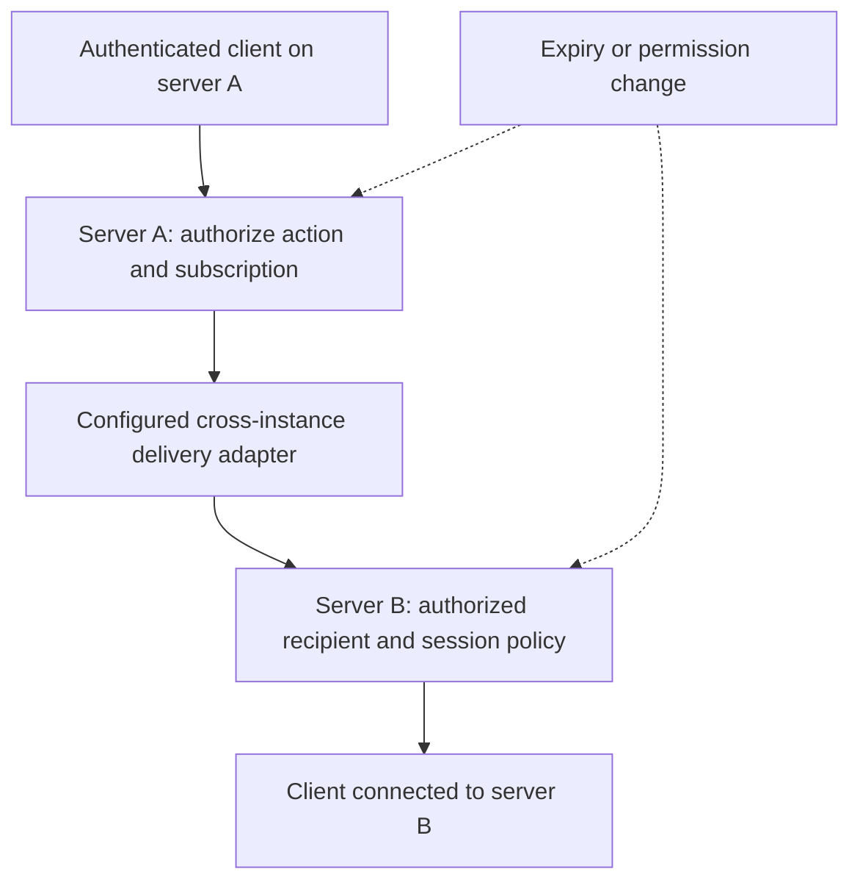
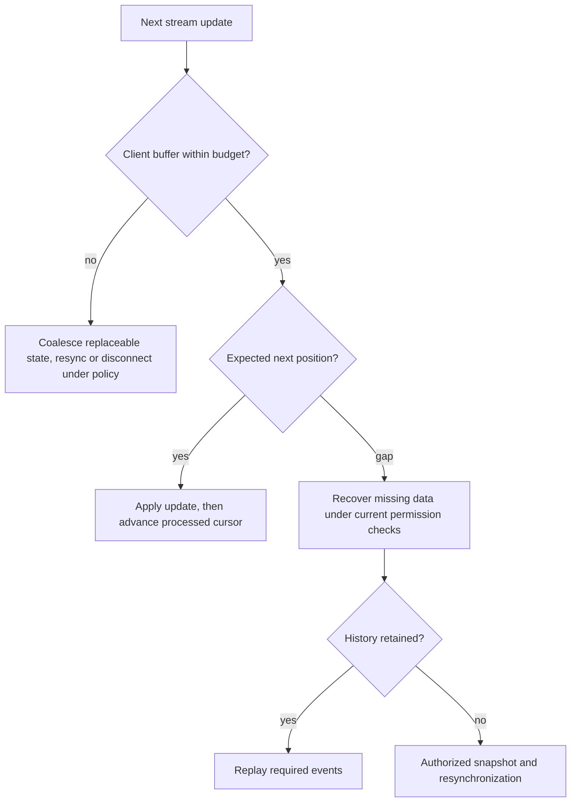
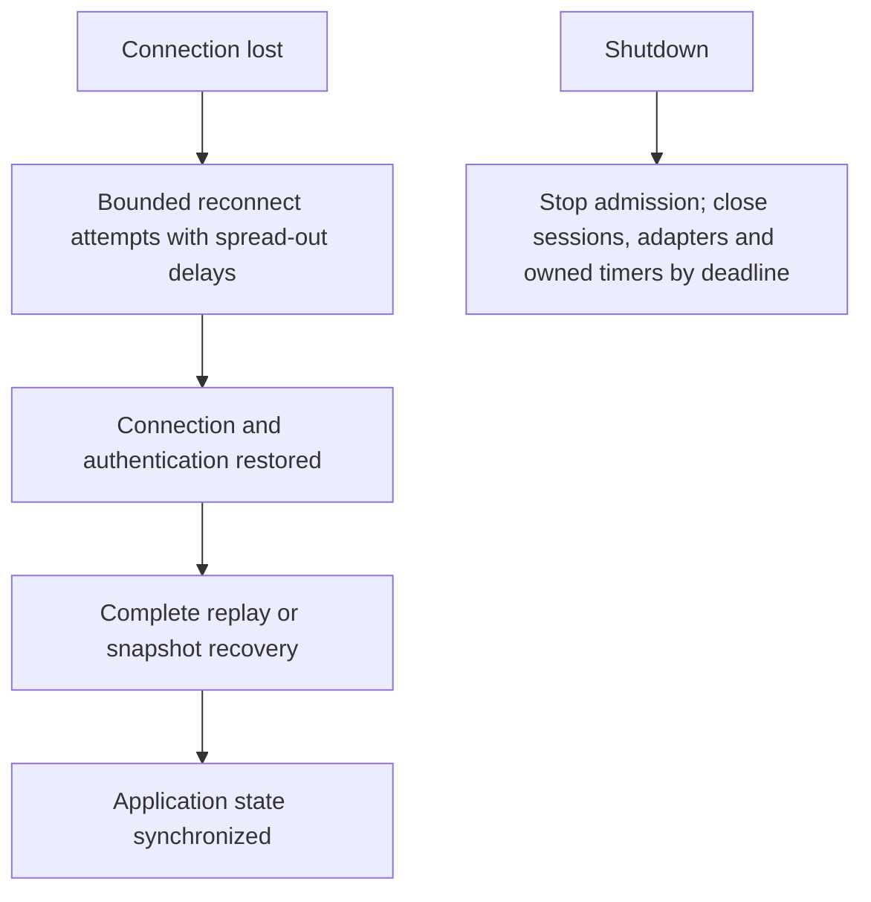
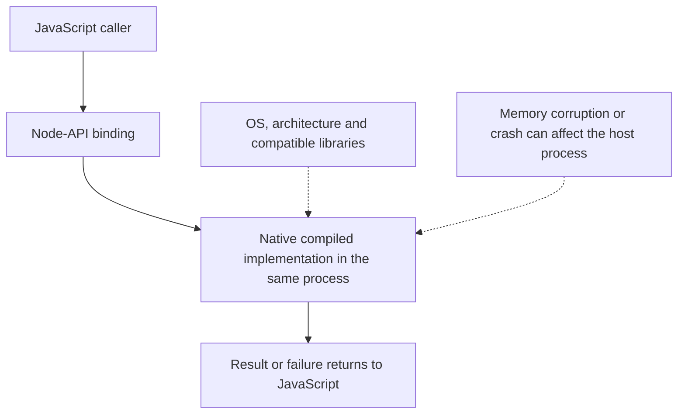
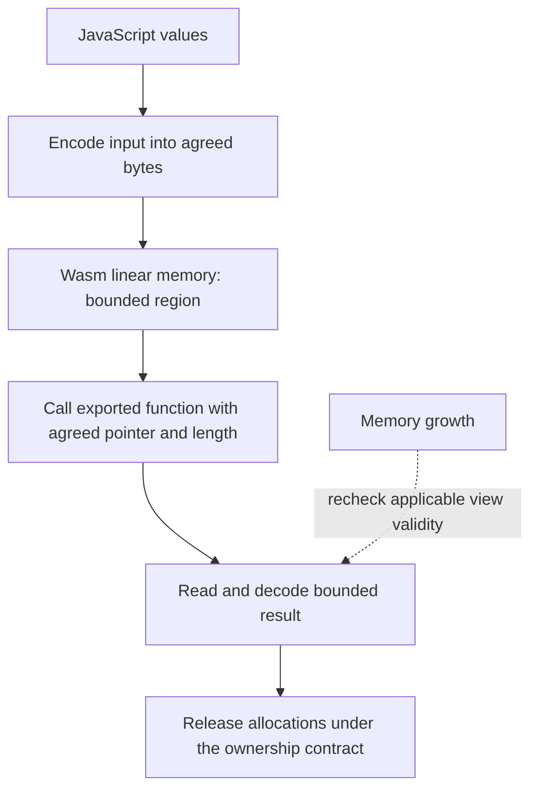

# Advanced real-time, native modules and WebAssembly

These specialist extensions build on [real-time foundations](./08-networking.md#t08-q06), [concurrency](./09-concurrency.md) and [performance measurement](./12-performance-and-v8.md). Use Node.js 24 for the worked examples; the real-time discussion uses Socket.IO 4.x. Native build commands below are explicitly macOS/arm64 study commands, not a portable release pipeline. References checked 2026-11-05.

<!-- tech-check: t08-q12; level: 5 -->

## How do authenticated real-time sessions work across multiple servers?

*Study depth: Advanced*

Level Up: L4 — Lead\
Tech Check level: ⭐⭐⭐⭐⭐

Source mapping: [R075](./requirements.md#r075), [R085](./requirements.md#r085).


<div class="notes-core-answer">

<p class="notes-core-answer__title">Core answer</p>

Verify credentials when a real-time connection starts, then check permission for each protected action and subscription. Define what happens when credentials expire or permissions are revoked while the connection stays open.

**A connected socket or room membership does not grant permanent permission.** Room names must come from authorized server state. With several servers, also arrange delivery between instances and, where the transport requires it, keep related requests on the same server. These deployment mechanisms do not replace application permission checks.

</div>

<span class="notes-section-label">**Authorize across instance delivery**</span>

An adapter can move events between servers. Each server still owns session permissions and authorized recipients.




:::: details Deeper explanation and additional examples

A connection can outlive a token, role or tenant membership. Validate credentials at entry, attach a narrow server-owned identity, enforce permissions on each action and expire/disconnect or refresh sessions under a stated policy. Derive room names from authorized server state; never let a caller join arbitrary tenant rooms. Recheck permissions during reconnect/recovery and before sending protected data when membership changes. A client-supplied user ID is not identity proof.

For browser connections, validate the expected Origin and authentication transport. CORS config alone is not a universal WebSocket authorization mechanism; native clients can forge Origin. Cookie-based sessions also need a cross-site WebSocket hijacking defense. Do not put bearer tokens in query strings that proxies/access logs retain. TLS protects transport, not application permissions.

Socket.IO multi-node operation has two separate needs:

- **Affinity for long-polling sessions:** repeated HTTP requests must reach the owning server. A WebSocket-only connection removes this polling-affinity requirement but gives up polling fallback; reconnect can still land elsewhere.
- **An adapter for broadcasts across servers:** an in-memory adapter only knows local sockets. A compatible shared adapter transports cross-node events; it does not automatically share your application session store or implement durable business replay.

Choose the adapter by actual guarantees. Redis Pub/Sub forwarding differs from a persistent stream. Socket.IO connection-state recovery has adapter-specific support and a bounded retention window; recovery may fail. With recovery configured, consider `skipMiddlewares:false` so a resumed session is not accepted using obsolete credentials. Even a successful handshake recheck does not replace per-action authorization.

::::

<span class="notes-section-label">**Practice and acceptance**</span>

Run two owned instances behind a local proxy. Test polling and WebSocket-only transports, cross-instance room delivery, token expiry, membership revocation and adapter loss. Accept with no cross-tenant delivery and a documented fallback when recovery is unavailable. References: [multiple nodes](https://socket.io/docs/v4/using-multiple-nodes/), [connection-state recovery](https://socket.io/docs/v4/connection-state-recovery/), [OWASP WebSocket security](https://cheatsheetseries.owasp.org/cheatsheets/WebSocket_Security_Cheat_Sheet.html).

---

<!-- tech-check: t08-q13; level: 5 -->

## How do slow consumers and replay cursors change a real-time design?

*Study depth: Advanced*

Level Up: L4 — Lead\
Tech Check level: ⭐⭐⭐⭐⭐

Source mapping: [R047](./requirements.md#r047).


<div class="notes-core-answer">

<p class="notes-core-answer__title">Core answer</p>

A slow client can accumulate pending updates, so **limit message sizes, each client's buffers, broadcast work and saved history**. Decide whether to combine replaceable updates, resynchronize or disconnect a client that cannot keep up.

A replay cursor records a position in a particular event stream. Use it to recover updates in the defined order. **A missing event must trigger recovery, not silently advance the cursor.** If the needed history has expired, provide a fresh snapshot only after checking the client's current permissions. A cursor is not permission to access the stream.

</div>

<span class="notes-section-label">**Handle a slow client and a missing event**</span>

Queue limits and replay position are separate controls. Do not advance past a gap as if the event was processed.




:::: details Deeper explanation and additional examples

A socket accepting writes does not mean its user has processed them. Measure buffered bytes, oldest pending age and application acknowledgments separately. Bound subscriptions per user and broadcasting work per turn. Disconnect/resynchronize a persistently slow consumer; coalesce replaceable state updates only when intermediate transitions are irrelevant. Payments, audit events and commands cannot be dropped as if they were cursor-position updates.

This pure reducer extends the foundation's duplicate/gap model with a stream epoch. A snapshot establishes a cursor; a new epoch requires a fresh snapshot. The `stream` comes from authenticated subscription state. This example accepts only one bounded integer value per update; real payload schemas remain domain-specific.

```js [replay-state.mjs]
import assert from "node:assert/strict";
function snapshot(stream, epoch, seq, value) {
  if (
    ![stream, epoch].every(
      (x) => typeof x === "string" && /^[a-z0-9-]{1,40}$/.test(x),
    ) ||
    !Number.isSafeInteger(seq) ||
    seq < 0 ||
    !Number.isSafeInteger(value)
  )
    throw new TypeError("invalid snapshot");
  return Object.freeze({ stream, epoch, seq, value });
}
function apply(state, event) {
  if (
    !event ||
    typeof event !== "object" ||
    !Number.isSafeInteger(event.seq) ||
    event.seq < 1 ||
    !Number.isSafeInteger(event.value)
  )
    throw new TypeError("invalid event");
  if (event.stream !== state.stream) throw new Error("wrong subscription");
  if (event.epoch !== state.epoch) return { kind: "snapshot-required", state };
  if (event.seq <= state.seq) return { kind: "duplicate", state };
  if (state.seq === Number.MAX_SAFE_INTEGER || event.seq !== state.seq + 1)
    return { kind: "snapshot-required", state };
  return {
    kind: "applied",
    state: snapshot(state.stream, state.epoch, event.seq, event.value),
  };
}
const initial = snapshot("tenant-a", "epoch-1", 4, 10);
const applied = apply(initial, {
  stream: "tenant-a",
  epoch: "epoch-1",
  seq: 5,
  value: 11,
});
assert.equal(applied.state.seq, 5);
assert.equal(initial.seq, 4);
assert.equal(
  apply(applied.state, {
    stream: "tenant-a",
    epoch: "epoch-1",
    seq: 5,
    value: 99,
  }).kind,
  "duplicate",
);
assert.equal(
  apply(initial, { stream: "tenant-a", epoch: "epoch-1", seq: 6, value: 99 })
    .kind,
  "snapshot-required",
);
assert.equal(
  apply(initial, { stream: "tenant-a", epoch: "epoch-2", seq: 5, value: 99 })
    .kind,
  "snapshot-required",
);
assert.throws(() =>
  apply(initial, { stream: "tenant-b", epoch: "epoch-1", seq: 5, value: 99 }),
);
assert.throws(() =>
  apply(initial, { stream: "tenant-a", epoch: "epoch-1", seq: NaN, value: 99 }),
);
```

A duplicate here is ignored under an assumption that the authoritative producer never assigns two different events to the same epoch/sequence. If that assumption can fail, detect conflicting event identity and resynchronize rather than calling it harmless. A cursor is not an authorization token. Validate an opaque/signed cursor's size, version, stream binding and expiry before using it for a database query; a signed cursor still needs current permissions.

Avoid the snapshot/subscription race: obtain a consistent snapshot with its high-water mark, then replay retained events after that mark before live delivery, or buffer live events while snapshotting with a strict bound. Define what happens when retention expires during recovery. Global ordering across independent streams is a separate, expensive requirement; do not promise it because TCP orders bytes on one connection.

::::

<span class="notes-section-label">**Practice and acceptance**</span>

Extend the feed with bounded history and a deliberately slow client. Accept when duplicate/gap/epoch/expired cursor cases are tested, memory stays within a stated budget and authorization is rechecked for the snapshot/replay. Reference: [Socket.IO delivery guarantees](https://socket.io/docs/v4/delivery-guarantees/), [Node stream backpressure](https://nodejs.org/en/learn/modules/backpressuring-in-streams).

---

<!-- tech-check: t08-q14; level: 5 -->

## How do you diagnose reconnect storms and shut down real-time services?

*Study depth: Advanced*

Level Up: L4 — Lead\
Tech Check level: ⭐⭐⭐⭐⭐

Source mapping: [R047](./requirements.md#r047).


<div class="notes-core-answer">

<p class="notes-core-answer__title">Core answer</p>

Detecting whether a connection is alive, allowing reconnect attempts and recovering missed data are separate tasks. **A reconnected socket does not prove the application has recovered its state.** Check replay or snapshot completion as well as connection success.

For shutdown, stop accepting new work, allow active work a limited time to finish, then close remaining connections by a deadline. Clear heartbeat and reconnect timers and close adapter connections too. Limit reconnect attempts and spread them out so many clients reconnecting together do not overwhelm the recovering service.

</div>

<span class="notes-section-label">**Stage reconnection before declaring recovery**</span>

Connection success is only one milestone. Timers, adapters and active work also need shutdown owners.




:::: details Deeper explanation and additional examples

Use library-supported ping/pong and proxy idle settings consistently. A heartbeat timeout can reflect congestion, a blocked event loop or a sleeping client; it is not proof of malicious behavior. Client reconnects need capped exponential backoff with jitter and server-side admission limits so a rolling restart does not synchronize every client. Retry only classified transient failures; repeatedly retrying revoked credentials wastes capacity.

An operational sequence is: mark unready, stop new subscriptions/upgrades, advertise a drain hint if your protocol supports it, stop new job admission, finish or checkpoint bounded active work, close sockets, then terminate remaining owned work at a deadline. Account for upgraded sockets separately from an HTTP server's ordinary request lifecycle. Clear heartbeat timers, reconnect timers and adapter connections; closing one layer does not necessarily close the others.

| Symptom | First evidence | Decision to test |
|---|---|---|
| Frequent disconnects at a fixed interval | Proxy idle timeout, heartbeat timings, event-loop delay | Align idle/heartbeat policy; fix stalls before enlarging every timeout |
| Duplicate notifications after reconnect | Operation IDs, producer retry and replay offsets | Idempotent effect + correct cursor; acknowledgments may be lost |
| Room delivery works on one instance only | Adapter health, local membership, transport affinity | Configure cross-node forwarding independently of load balancing |
| Memory rises with slow clients | Per-client buffered bytes/age, subscriber counts | Bound/coalesce/disconnect; do not just raise heap size |

Use bounded metric labels for disconnect class/transport, and safe IDs in logs/traces for a particular session. A room containing ten thousand sockets makes one broadcast a fan-out capacity problem. Load-test the selected distribution and recovery strategy; an echo fixture does not measure it.

::::

<span class="notes-section-label">**Practice and acceptance**</span>

Extend the [existing networking fixtures](./08-networking.md#t08-q07) with owned proxy restart, adapter loss, slow client and rolling shutdown. Accept when no stale session receives protected events, recovery/fallback is explicit, buffers and drain time are bounded and every owned handle closes. References: [Socket.IO troubleshooting](https://socket.io/docs/v4/troubleshooting-connection-issues/), [delivery guarantees](https://socket.io/docs/v4/delivery-guarantees/).

---

<!-- tech-check: t12-q08; level: 5 -->

## What does a native Node-API module add, and what can go wrong?

*Study depth: Intermediate*

Level Up: L3 — Senior\
Tech Check level: ⭐⭐⭐⭐⭐

Source mapping: [R170](./requirements.md#r170).


<div class="notes-core-answer">

<p class="notes-core-answer__title">Core answer</p>

A native addon makes compiled code available to JavaScript. Node-API provides a stable binary interface for compatible Node-API versions, called ABI stability. Direct use of V8 or internal Node APIs has different compatibility risks. Even with Node-API, binaries still need the correct operating system, architecture and library compatibility.

**Native code runs with the host process's privileges and can corrupt or crash that process.** It adds build, deployment and cleanup responsibilities. A long synchronous native call can also block its calling thread; compiled code is not automatically asynchronous or isolated.

</div>

<span class="notes-section-label">**See the native process boundary**</span>

A native addon executes with the process privileges. A synchronous native call occupies its calling thread until it returns.




:::: details Deeper explanation and additional examples

Use a native dependency for an existing system library, specialized hardware or a measured hot path. It adds compiler/toolchain, OS/architecture/libc and transitive-library compatibility work. Node-API ABI stability does not produce one binary for every operating system or guarantee a third-party library's ABI. Check the target Node-API version, packaging/prebuild matrix and fallback build before release. `node-addon-api` is a C++ wrapper over Node-API, not the same thing as direct V8 bindings.

This intentionally small C++ addon checks inputs before adding two bounded integers. Every Node-API result used by the example is checked; error returns stop execution. Put this in an owned study directory:

```cpp [study.cc]
#include <node_api.h>
#include <cmath>

static napi_value Add(napi_env env, napi_callback_info info) {
  size_t argc = 3;
  napi_value args[3];
  if (napi_get_cb_info(env, info, &argc, args, nullptr, nullptr) != napi_ok) {
    napi_throw_error(env, nullptr, "cannot read arguments"); return nullptr;
  }
  if (argc != 2) {
    napi_throw_type_error(env, nullptr, "expected two numbers"); return nullptr;
  }
  double a, b;
  if (napi_get_value_double(env, args[0], &a) != napi_ok ||
      napi_get_value_double(env, args[1], &b) != napi_ok) {
    napi_throw_type_error(env, nullptr, "expected numbers"); return nullptr;
  }
  if (!std::isfinite(a) || !std::isfinite(b) || std::trunc(a) != a || std::trunc(b) != b ||
      std::abs(a) > 1000000 || std::abs(b) > 1000000) {
    napi_throw_range_error(env, nullptr, "integers outside study range"); return nullptr;
  }
  napi_value result;
  if (napi_create_double(env, a + b, &result) != napi_ok) {
    napi_throw_error(env, nullptr, "cannot create result"); return nullptr;
  }
  return result;
}
static napi_value Init(napi_env env, napi_value exports) {
  napi_value fn;
  if (napi_create_function(env, "add", NAPI_AUTO_LENGTH, Add, nullptr, &fn) != napi_ok ||
      napi_set_named_property(env, exports, "add", fn) != napi_ok) {
    napi_throw_error(env, nullptr, "cannot initialize addon"); return nullptr;
  }
  return exports;
}
NAPI_MODULE(study_addon, Init)
```

For the macOS/arm64 lab with Homebrew Node headers and Command Line Tools, the direct compile command is:

```sh
c++ -std=c++17 -shared -fPIC -undefined dynamic_lookup \
  -I/opt/homebrew/include/node study.cc -o study.node
```

The include path and linker flags are platform-specific. A normal cross-platform addon uses a reviewed `binding.gyp`/node-gyp or CMake setup and per-platform release checks. Compilation can run arbitrary dependency lifecycle scripts; review the source/package rather than enabling builds indiscriminately.

```js [native-check.mjs]
import assert from "node:assert/strict";
import { createRequire } from "node:module";
const { add } = createRequire(import.meta.url)("./study.node");
assert.equal(add(20, 22), 42);
for (const args of [
  [],
  [1],
  [1, 2, 3],
  ["1", 2],
  [NaN, 2],
  [Infinity, 2],
  [0.5, 2],
  [1000001, 2],
])
  assert.throws(() => add(...args));
```

This tiny synchronous function is bounded; a long native computation would still block its calling thread. Async native work requires correct ownership, completion/cancellation and safe JavaScript-thread interaction. Node-API async work can contend with the libuv pool; arbitrary native threads cannot call ordinary JavaScript APIs directly. Thread-safe functions have lifecycle and queue limits. A worker thread isolates an event loop, not native memory corruption from the process; a separate process gives a stronger crash boundary.

::::

<span class="notes-section-label">**Practice and acceptance**</span>

Compile/run this study addon, then design the lifetime/cancellation contract for a slower operation without implementing unsafe background callbacks. Accept with negative input tests, checked native statuses, a supported-platform matrix and a clear reason to prefer native code over JavaScript/worker/process alternatives. References: [Node-API](https://nodejs.org/api/n-api.html), [ABI stability](https://nodejs.org/en/learn/modules/abi-stability), [node-gyp](https://github.com/nodejs/node-gyp).

---

<!-- tech-check: t12-q09; level: 5 -->

## How does WebAssembly exchange values and memory with Node.js?

*Study depth: Intermediate*

Level Up: L3 — Senior\
Tech Check level: ⭐⭐⭐⭐⭐

Source mapping: [R170](./requirements.md#r170).


<div class="notes-core-answer">

<p class="notes-core-answer__title">Core answer</p>

A WebAssembly module is compiled code with explicitly declared imports and exports. It exchanges data through function values and, where used, linear memory: a byte-addressed region whose layout the host and module must agree on.

**Define conversions, memory bounds and who owns each allocation.** Strings and arrays need an agreed encoding and pointer/length arrangement. **Wasm integer rules differ from JavaScript `Number` rules**, including overflow behavior. Memory growth can also invalidate existing views, so follow the rules for the specific shared or unshared memory in use rather than assuming old views stay valid.

</div>

<span class="notes-section-label">**Agree on memory layout at the boundary**</span>

For a byte-oriented interface, the host and module must agree on encoding, bounds and allocation lifetime.




:::: details Deeper explanation and additional examples

This text representation declares one exported i32 addition function:

```text
(module
  (func (export "add") (param i32 i32) (result i32)
    local.get 0
    local.get 1
    i32.add))
```

The matching binary below avoids requiring a WAT compiler for the first experiment. The sections describe the function type, function, export and code. Real projects normally compile source/WAT with a pinned toolchain and verify the artifact, rather than hand-editing bytes.

```js [wasm-check.mjs]
import assert from "node:assert/strict";
const bytes = Uint8Array.from([
  0, 97, 115, 109, 1, 0, 0, 0, 1, 7, 1, 96, 2, 127, 127, 1, 127, 3, 2, 1, 0, 7,
  7, 1, 3, 97, 100, 100, 0, 0, 10, 9, 1, 7, 0, 32, 0, 32, 1, 106, 11,
]);
const { instance } = await WebAssembly.instantiate(bytes, {});
function add(a, b) {
  if (
    ![a, b].every(
      (n) => Number.isInteger(n) && n >= -2147483648 && n <= 2147483647,
    )
  )
    throw new TypeError("expected signed i32 inputs");
  return instance.exports.add(a, b);
}
assert.equal(add(20, 22), 42);
assert.equal(add(2147483647, 1), -2147483648);
assert.throws(() => add("1", 2));
assert.throws(() => add(2 ** 32, 2));
await assert.rejects(WebAssembly.compile(Uint8Array.from([0, 1, 2])));
const memory = new WebAssembly.Memory({ initial: 1, maximum: 2 });
const oldView = new Uint8Array(memory.buffer);
oldView[0] = 42;
memory.grow(1);
assert.equal(oldView.byteLength, 0);
const currentView = new Uint8Array(memory.buffer);
assert.equal(currentView[0], 42);
assert.equal(currentView.byteLength, 131072);
assert.throws(() => memory.grow(1), RangeError);
```

`i32.add` wraps modulo 2³²; JavaScript Number addition is not a drop-in oracle at overflow. i64 boundaries generally use BigInt. Strings/arrays require an agreed encoding, allocation, pointer/length and ownership contract. Validate bounds and avoid stale views after growth: the demonstration uses **unshared memory**, whose old buffer detaches on growth. Shared-memory behavior differs. Linear memory pages are 64 KiB; a maximum bounds this memory, not all compilation/host resource costs.

Imports grant capabilities. A module without file/network imports does not thereby gain them, but imported JavaScript can expose them. Wasm does not automatically enforce execution deadlines or protect availability from infinite loops, huge compilation work or excessive host calls. WASI is a separate system-interface contract with its own capability/runtime limitations; it is not ordinary browser-style Wasm or a complete hostile-code sandbox.

::::

<span class="notes-section-label">**Practice and acceptance**</span>

Compile an owned numeric function from WAT or a source language, compare boundary/overflow results with a deliberate reference and add a validated memory-transfer example. Accept with documented encoding/ownership, refreshed views and malformed-module/input tests. References: [Node with WebAssembly](https://nodejs.org/en/learn/getting-started/nodejs-with-webassembly), [WebAssembly specification](https://webassembly.github.io/spec/), [Node WASI security](https://nodejs.org/api/wasi.html).

---

<!-- tech-check: t12-q10; level: 5 -->

## How do you choose and operate a specialist execution boundary?

*Study depth: Advanced*

Level Up: L4 — Lead\
Tech Check level: ⭐⭐⭐⭐⭐

Source mapping: [R170](./requirements.md#r170).


<div class="notes-core-answer">

<p class="notes-core-answer__title">Core answer</p>

**Choose the simplest execution option that meets measured requirements.** Compare ordinary JavaScript, worker threads, a native addon, WebAssembly and a separate process or service according to the needed computation, separation and deployment constraints.

**Native code and WebAssembly do not automatically make complete requests faster or hostile inputs safe.** Include data conversion, copying, startup, queues and useful computation in measurements. Test failures, invalid input, cancellation and shutdown, and define limits on time, memory and active work. Keep permissions and cleanup explicit for the chosen option.

</div>

:::: details Deeper explanation and additional examples

| Choice | Good reason | Cost/risk to investigate |
|---|---|---|
| JavaScript on main thread | Small bounded work | Event-loop latency if work grows |
| Worker thread | CPU work with manageable structured clone/transfer | Startup, queue bounds, memory and cancellation; shared process |
| Native Node-API addon | Required native library/hardware or measured hot path | Build/ABI/platform matrix, native crashes and lifecycle |
| WebAssembly | Portable computation with explicit imports and data boundary | Compilation, copying/encoding, host calls, integer/memory semantics |
| Separate process/service | Stronger crash boundary or distinct runtime | IPC/serialization, supervision, partial failure and deployment |

Benchmark the full path: cold compile/load, warm-up, useful work, data encoding/copying, queue time, concurrency, latency distribution and resident memory. Compare equivalent algorithms/results under the same workload. A million tiny cross-boundary calls can cost more than one batched operation. Measure batching against memory/latency constraints rather than removing all limits for a faster benchmark.

Use trusted artifacts and verify integrity/provenance, supported versions and deployment architecture. Test invalid inputs, oversized work, cancellation, initialization failure, shutdown during active work and missing incompatible binaries. In a process model, the supervisor owns deadline, kill and reaping; an ignored Promise timeout does not stop computation. A worker/process is not by itself a permissions sandbox: choose OS/container restrictions and narrow capabilities for the actual threat model.

::::

<span class="notes-section-label">**Practice and acceptance**</span>

Add one justified specialist feature to the products service: bounded image/numeric processing or a real library integration. Keep a reference implementation, test equivalent results, measure end-to-end behavior and define rollback/fallback. Accept only with reproducible evidence, bounded queues/time/memory, clean shutdown and a release matrix. Advanced native threading, custom Wasm runtimes and multi-region real-time recovery may remain optional after this introductory implementation; record the limit rather than claiming mastery.

## Revision and mixed practice

Try each question without opening its answer. Explain the reason, not just the term; then expand **Show answer** to check. Diagram questions link back to the visual so you can trace its parts and arrows.

<!-- revision-covers: t08-q12 -->

<span class="notes-section-label">**1. Explain diagram — Trace the [multi-server session diagram](#t08-q12). Why does adapter delivery or room membership not grant permanent access after a credential expires or permissions change?**</span>

::: details Show answer

Server A authorizes its connection/action and sends through the configured cross-instance adapter; server B still needs an authorized recipient/session policy. Adapter delivery and room membership do not renew expired credentials or permanently grant access. Recheck or revoke protected subscriptions under the session policy, and derive room membership from trusted state. Transport affinity and cross-node distribution solve deployment concerns separately.

[Revisit the explanation and examples](#t08-q12).

:::


---

<!-- revision-covers: t08-q13 -->

<span class="notes-section-label">**2. Scenario — Does a Redis adapter give a disconnected client durable replay automatically?**</span>

::: details Show answer

No. Check the selected adapter's persistence/recovery contract and provide authorized snapshot/replay fallback.

[Revisit the explanation and examples](#t08-q13).

:::


---

<!-- revision-covers: t08-q13 -->

<span class="notes-section-label">**3. Explain diagram — Trace the slow-consumer and gap branches in the [replay diagram](#t08-q13). When should a cursor advance, and what happens if required history expired?**</span>

::: details Show answer

**Bound each client's buffers and recover gaps without silently advancing the cursor.** If history expired, use an authorized resynchronization or snapshot policy. Advance the processed cursor only for the defined completed position, not silently over a missing event. Choose a bounded slow-client policy such as coalescing replaceable state, authorized resynchronization or disconnect, and enforce current permissions on replay too.

[Revisit the explanation and examples](#t08-q13).

:::


---

<!-- revision-covers: t08-q14 -->

<span class="notes-section-label">**4. Compare — A reconnect succeeds during a reconnect storm, but the UI missed updates. What else establishes recovered state, and which session/adapter/timer owners must cooperate during shutdown?**</span>

::: details Show answer

**Connection recovery, session-state recovery and heartbeat are separate concerns.** Spread and limit reconnects; close sessions, adapters and timers within shutdown deadlines.

[Revisit the explanation and examples](#t08-q14).

:::


---

<!-- revision-covers: t12-q08 -->

<span class="notes-section-label">**5. Scenario — Does a Node-API binary built for macOS run unchanged on Linux?**</span>

::: details Show answer

No. Stable Node-API does not erase OS, architecture, linker and external-library differences.

[Revisit the explanation and examples](#t12-q08).

:::


---

<!-- revision-covers: t12-q08 -->

<span class="notes-section-label">**6. Compare — Why can a Node-API addon with compatible ABI still block or crash its host, and why does OS-compatible packaging not establish isolation?**</span>

::: details Show answer

**Node-API stability does not remove platform or library compatibility requirements.** Native code shares host authority and can crash the process or block its calling thread. It runs native code with process privileges, not inside an automatically asynchronous or hostile-code-safe boundary. Account for build, library, deployment and resource-closure contracts.

[Revisit the explanation and examples](#t12-q08).

:::


---

<!-- revision-covers: t12-q09 -->

<span class="notes-section-label">**7. Explain diagram — Use the [Wasm memory diagram](#t12-q09) to explain encoding, pointer/length, bounds and ownership. Why should JavaScript integer assumptions and old memory views not be reused blindly?**</span>

::: details Show answer

The host encodes values into agreed bounded bytes, invokes an export with its pointer/length contract and decodes the bounded result. Both sides need explicit allocation ownership and encoding; Wasm integer and overflow rules differ from JavaScript Number behavior. Memory growth can change view validity under the chosen shared/unshared memory contract, so do not keep using old views without applying those rules. Include conversion and copying costs in performance evidence.

[Revisit the explanation and examples](#t12-q09).

:::


---

<!-- revision-covers: t12-q10 -->

<span class="notes-section-label">**8. Scenario — Can a timed-out Promise stop a Wasm infinite loop on the main thread?**</span>

::: details Show answer

No. A blocked thread cannot run the timeout callback; use a controlled execution boundary and external termination where appropriate.

[Revisit the explanation and examples](#t12-q10).

:::


---

<!-- revision-covers: t12-q10 -->

<span class="notes-section-label">**9. Choose — A Wasm kernel is faster in isolation but requires large copies per request. Which complete-path costs and failure checks decide whether to adopt it?**</span>

::: details Show answer

**Compare the complete useful workload, including conversion, startup, queues and copying.** Native or Wasm execution does not automatically improve requests or secure hostile inputs. Include useful computation, conversion, copying, startup and queues in representative measurements. Test invalid inputs, cancellation and termination at the actual execution boundary with explicit authority and cleanup.

[Revisit the explanation and examples](#t12-q10).

:::
