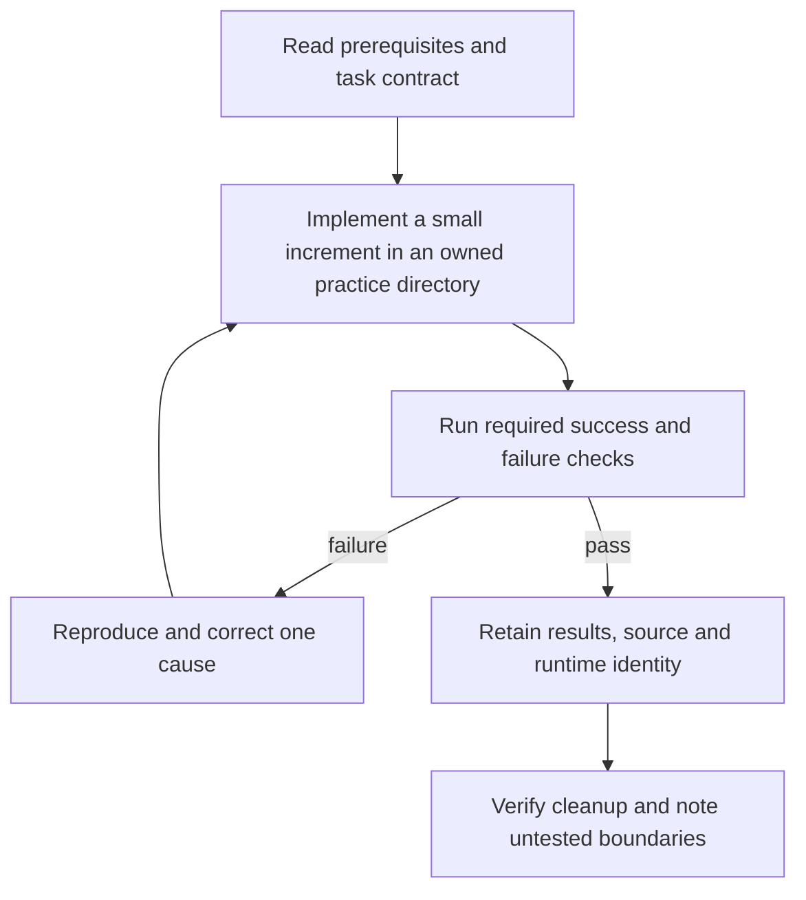

# Node.js practice

**Every task still needs your own practice.** These pages describe what to build and check. Running a supplied example does not complete an independent exercise.

Start with the [Node.js course](../../node-js/index.md). Before these exercises, learn JavaScript values, functions, scope, arrays, objects and basic promises. The first runtime exercises need only Node and a terminal. Express, databases and cloud access come later.

Begin with [the bounded log analyzer](./core-project.md). “Bounded” means it limits input size, time or active work. Build a small CLI, then an HTTP service accessible only on your machine. Check file handling, streams, cancellation, tests, diagnosis and shutdown. Complete the N-01–06 criteria yourself; they contribute to the existing P-332 project.

## Topic-to-practice map

Read the JavaScript basics above and the earlier runtime chapters before each core exercise. Backend exercises also need HTTP and input validation. Database exercises need SQL and a disposable database you are allowed to use. Deployment exercises need a working service and an environment you control. Follow the linked setup before running anything that changes or deletes data.

For each row, keep the evidence record described below and check the exercise's required success and failure behavior. The larger projects reuse one application; you do not need to build 30 unrelated products.

| Topic | Ready-to-use exercises | Integration and scope |
|---|---|---|
| A Minimal AWS Service Slice: Topology, IAM and Cost | [Specification](./aws-service-slice.md) | P-333; later deployment and recovery practice; cloud/cluster work is optional |
| Browser CSP: Nonces, Reports and Deployment Evidence | [Specification](./browser-csp.md) | P-331; focused API, data or security practice |
| An Executed Node/PostgreSQL Container Lab | [Specification](./container-deployment-lab.md) | P-333; later deployment and recovery practice; cloud/cluster work is optional |
| Deterministic Cursor Pagination | [Specification](./cursor-pagination.md) | P-331; focused API, data or security practice |
| PostgreSQL Backup, Restore and Recovery | [Specification](./database-recovery.md) | P-333; later deployment and recovery practice; cloud/cluster work is optional |
| Dates, Instants, Time Zones and Calendar Rules | [Specification](./dates-and-time-zones.md) | P-331; focused API, data or security practice |
| Deploy, restore and roll back a small complete stack | [Specification](./full-stack-deployment.md) | P-333; later deployment and recovery practice; cloud/cluster work is optional |
| GraphQL: a bounded catalogue query | [Specification](./graphql-basics.md) | P-331/P-332; optional alternative when a requirement needs it |
| Durable jobs and scheduled work | [Specification](./jobs-and-schedules.md) | P-331/P-333; optional background work that must survive restarts |
| Node.js Foundations | [Specification](./module-01-nodejs-foundations.md) | P-332 / N-01–06; core runtime, HTTP, testing or troubleshooting |
| Node.js Standard Library | [Specification](./module-02-standard-library.md) | P-332 / N-01–06; core runtime, HTTP, testing or troubleshooting |
| EventEmitter, Buffers, and Streams | [Specification](./module-03-events-buffers-streams.md) | P-332 / N-01–06; core runtime, HTTP, testing or troubleshooting |
| Testing Node.js Applications | [Specification](./module-04-testing.md) | P-332 / N-01–06; core runtime, HTTP, testing or troubleshooting |
| Networking in Node.js | [Specification](./module-05-networking.md) | P-332 / N-01–06; core runtime, HTTP, testing or troubleshooting |
| Express and Layered Architecture | [Specification](./module-06-express-architecture.md) | P-331; later backend, database and identity practice |
| NoSQL Databases, MongoDB, and Mongoose | [Specification](./module-07-mongodb-mongoose.md) | P-331/P-332; optional alternative when a requirement needs it |
| Relational Databases, PostgreSQL, and MikroORM | [Specification](./module-08-postgresql-mikroorm.md) | P-331; later backend, database and identity practice |
| Authentication and Authorization | [Specification](./module-09-authentication-authorization.md) | P-331; later backend, database and identity practice |
| Production-Ready Node.js Applications | [Specification](./module-10-production-ready-applications.md) | N-06 / P-331 and P-333; startup and shutdown first; deployment later |
| Performance and Diagnostics | [Specification](./module-11-performance-diagnostics.md) | P-332 / N-01–06; core runtime, HTTP, testing or troubleshooting |
| Resilient Architecture and Distributed Systems | [Specification](./module-12-resilient-distributed-systems.md) | P-331/P-333; optional background work that must survive restarts |
| OIDC Login Transactions and Signed CSRF Tokens | [Specification](./oidc-and-csrf-lab.md) | P-331/P-332; optional alternative when a requirement needs it |
| SSE, Bounded Polling and gRPC: Choosing a Transport | [Specification](./realtime-transports.md) | P-331/P-332; optional alternative when a requirement needs it |
| Redis Adapters: Cache Boundaries and Shared Limits | [Specification](./redis-adapters.md) | P-331/P-332; optional alternative when a requirement needs it |
| Build Artifacts and Database Rollback Compatibility | [Specification](./release-artifact-compatibility.md) | P-333; later deployment and recovery practice; cloud/cluster work is optional |
| REST contracts: OpenAPI, runtime schemas and drift checks | [Specification](./rest-contract-workbench.md) | P-331; focused API, data or security practice |
| Retention, Expiry and Enforced Deletion | [Specification](./retention-and-deletion.md) | P-331; focused API, data or security practice |
| A Bounded Text Upload and Its Threat Model | [Specification](./safe-text-uploads.md) | P-331; focused API, data or security practice |
| Verify signed webhooks before applying effects | [Specification](./signed-webhooks.md) | P-331; focused API, data or security practice |
| SQL Query Workbench: From Rows to Reports | [Specification](./sql-query-workbench.md) | P-331; focused API, data or security practice |

**Turn reading into a checked exercise**

The loop ends with retained evidence and cleanup. A reading checkmark does not replace running the task yourself.

## Evidence and progression

Work in a disposable practice directory with made-up test data and the runtime version stated in the chapter. Preserve the application template's scripts and database settings. Never change restricted `src/tests` files.

For each task, record the source revision, runtime and lockfile; expected and actual results; a failing example and its fix; cleanup; and checks you did not run. Do not mark success before checking it. Use the [evidence record](../learning-projects.md#retain-a-real-evidence-record).

The [backend project](../backend-project.md) defines **P-332** for runtime and stream failures, **P-331** for a later authenticated API with a database, and **P-333** for deployment and recovery. These still need your own implementation and checks.
