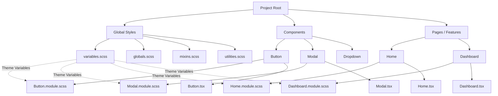
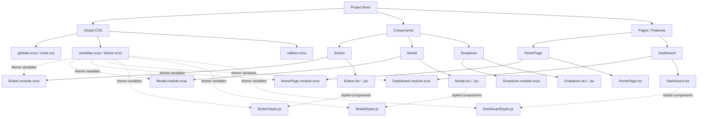

# How would you organize CSS on huge project?

Canonical owner: large-project stylesheet/token boundaries, Sass module output and migration. [Runtime themes and SSR first paint](./styling_react_apps.md) remain a distinct React integration concern.

Large-project CSS needs explicit ownership of global rules, component styles and public tokens.

---

## **Adopt a Component-Based Structure** {#_1%EF%B8%8F%E2%83%A3-adopt-a-component-based-structure}

If your project uses **React / Vue / Angular**, organize CSS **per component** whenever possible.

* **CSS Modules**: a bundler maps local class names from `.module.css`/`.module.scss`. Sass `@use`/`@forward` modules organize compile-time symbols; they do not hash or isolate emitted selectors by themselves.
* Co-locate styles with components:

  ```plaintext
  /components/Button/
    Button.tsx
    Button.module.scss
  ```

**Benefits:**

* Local class-name mapping reduces accidental collisions. Global selectors, inheritance, custom properties and cascade order still cross component boundaries.
* Easier to refactor or move components.

---

## **Global Styles / Theme** {#_2%EF%B8%8F%E2%83%A3-global-styles-theme}

Some things are **global** and should be centralized:

* **CSS Variables (Custom Properties)** for runtime colors, spacing and typography. A var() custom property cannot substitute into an ordinary media-query condition; use a reviewed literal or compile-time Sass breakpoint there.
* **Reset / Normalize CSS** (like `normalize.css`).
* **Global utility classes** (e.g., `.hidden`, `.sr-only`).

Example:

```
/styles/
  variables.scss
  globals.scss
  mixins.scss
  utilities.scss
```

* Import global styles at the top level (App root).

---

## **Use a CSS Methodology** {#_3%EF%B8%8F%E2%83%A3-use-a-css-methodology}

Structured naming helps avoid conflicts:

* **BEM (Block-Element-Modifier)** → classic, works well with vanilla CSS/SASS.
* **SMACSS / ITCSS** → alternative organization conventions; team discipline and actual dependencies determine their value.

**Example BEM:**

```scss
.button { }
.button__icon { }
.button--primary { }
```

---

## **Preprocessor / PostCSS** {#_4%EF%B8%8F%E2%83%A3-preprocessor-postcss}

* Native CSS already supplies custom properties and nesting on supporting browsers; Sass remains useful for compile-time variables, mixins/functions and modules. Check the target browser/build support matrix instead of calling every such capability Sass-only. Use current Dart Sass @use/@forward rather than deprecated Sass @import.
* Optionally use **PostCSS** for autoprefixing, minification, and modern CSS features.

---

## **Modular & Lazy-Loaded Styles** {#_5%EF%B8%8F%E2%83%A3-modular-lazy-loaded-styles}

* Split CSS per **feature / route / page**.
* Only load styles that are needed for the page → reduces initial load time.
* Combine with **code splitting** in React / Vue.

---

## **Utility / Atomic Classes (Optional)** {#_6%EF%B8%8F%E2%83%A3-utility-atomic-classes-optional}

* TailwindCSS or custom utility classes for repetitive styling.
* Works well alongside component styles to reduce duplication.

---

## **Theming & Dark Mode** {#_7%EF%B8%8F%E2%83%A3-theming-dark-mode}

* Use **CSS variables** for colors, fonts, spacing.
* Switch themes by changing root variables.
* Example:

```scss
:root {
  --color-primary: #1a73e8;
}
[data-theme="dark"] {
  --color-primary: #8ab4f8;
}
```

---

## **Folder Structure Example for Huge Project** {#_8%EF%B8%8F%E2%83%A3-folder-structure-example-for-huge-project}

```
/src
  /components
    /Button
      Button.tsx
      Button.module.scss
    /Modal
      Modal.tsx
      Modal.module.scss
  /pages
    /Home
      Home.tsx
      Home.module.scss
  /styles
    globals.scss
    variables.scss
    mixins.scss
    utilities.scss
```

---

## **Best Practices** {#_9%EF%B8%8F%E2%83%A3-best-practices}

* Keep selectors **shallow**, avoid deep nesting.
* Prefer **composition over inheritance**.
* Use CSS Modules as the primary scoped-class mechanism; runtime CSS-in-JS is an alternative with its own SSR/extraction/ordering costs, not a second required stack.
* **Audit unused CSS** periodically (DevTools coverage).
* Document design tokens (colors, spacing, typography).

---

 **Summary**:

* Component-level CSS (modules)
* Global styles for themes, resets, utilities
* CSS methodology (BEM / ITCSS)
* Preprocessor (SASS) or PostCSS
* Lazy-loading & splitting for performance
* Utility classes for repeatable patterns

---


### **Mermaid Diagram (CSS Organization)**



---

### **How to read it**

* **Global Styles** (`B`)

  * Centralized variables, mixins, utilities.
  * Shared across all components and pages.

* **Components** (`C`)

  * Each component has a `.module.scss` for scoped styles.
  * Styles live next to the component code.

* **Pages / Features** (`D`)

  * Larger page-level or feature-level styles.
  * Also scoped via CSS Modules.

* **Theme Variables** (dashed arrows)

  * Variables from `variables.scss` are consumed by both components and pages for consistent colors, fonts, spacing.

---

 **Key Takeaways**

1. **Local + Global balance** → component isolation + reusable themes.
2. **Scalable folder structure** → easy to navigate and maintain.
3. **Controlled growth** → review new selectors, tokens and global effects; a folder structure cannot guarantee isolation.

---


### **Mermaid Diagram: CSS Types in a Huge Project**



---

### **Explanation**

1. **Global CSS**

   * Resets, base styles, utility classes, and theme variables.
   * Shared across all components and pages.

2. **CSS Modules**

   * Component-scoped styles (`.module.scss`).
   * Localizes class names; cascade, global rules and inheritance still need review.

3. **Styled Components**

   * Optional CSS-in-JS for dynamic or prop-driven styles.
   * Can consume the same theme variables as global or CSS Modules.

4. **Theme Variables**

   * Centralized variables (`variables.scss`) flow into **all CSS types** for consistent colors, spacing, and fonts.

---

 **Benefits of this structure**

* **Isolation + Scalability**: Components can use CSS Modules or Styled Components while global styles provide shared resources.
* **Maintainable**: Clear ownership helps assess which unrelated consumers might be affected by a change.
* **Flexible**: Mix of CSS Modules + Styled Components works well in large teams.


## Token API and component contract

Treat semantic tokens as a versioned public API: `--surface`, `--text`, `--action-bg` express roles, while raw palette values remain implementation details. A component consumes documented semantic roles and exposes deliberate variants, states, focus behavior and disabled semantics. CSS cannot make a clickable div equivalent to a native button. Document which component-level overrides are supported instead of asking consumers to target undocumented descendants or increase specificity.

When renaming `--brand` to `--action-bg`, keep a temporary fallback for old consumers, migrate one component/route, then remove the compatibility alias in an explicit breaking token release after checking every supported theme. The alias direction matters: define the new token from the old value during migration so changing the old theme token still affects new consumers.

A var() alias resolves where it is declared: a nested theme changing --brand must redeclare --action-bg there rather than inherit an already-computed parent value. The dark scope below does so. Never create cyclic var() aliases. Invalid custom-property values can fail at computed-value time; a fallback does not type-check an arbitrary supplied token value.

```scss
// _tokens.scss: compile-time module, runtime declarations emitted separately.
$wide: 48rem;
@mixin theme {
  :root { --brand: #174ea6; --action-bg: var(--brand); --action-text: #fff; --focus: #111; }
  [data-theme="dark"] { --brand: #9bbcff; --action-bg: var(--brand); --action-text: #101820; --focus: #fff; }
}
```

```scss
// component.scss: Sass alone does not turn .button into a hashed CSS Module.
@use "tokens";
@layer reset, base, components, utilities;
@layer base { @include tokens.theme; }
@layer components {
  .button {
    color: var(--action-text);
    background: var(--action-bg, var(--brand));
    padding: .5rem 1rem;
  }
  .button:focus-visible { outline: 2px solid var(--focus); outline-offset: 2px; }
  .button:disabled { opacity: .6; cursor: not-allowed; }
  @media (min-width: tokens.$wide) { .button { padding-inline: 1.5rem; } }
}
```

The Sass breakpoint emits a literal48rem; do not write `@media(min-width:var(--wide))`. `@layer` establishes cascade order for participating rules, not a sandbox. Normal unlayered author CSS outranks normal layered author CSS; important declarations reverse layer ordering. Audit existing unlayered vendor/global styles before assuming layers reduce priority conflicts. CSS Modules localizes class names but does not stop an inherited color or global `button` rule from affecting a component. Sass compilation proves syntax/emitted values, not contrast, focus visibility or computed cascade in a browser.

## SSR, style cost and migration evidence

Server/static-extracted CSS Modules can avoid runtime style generation, but still deliver CSS bytes and require correct route discovery/order. Runtime CSS-in-JS can offer prop-driven APIs while adding generation/insertion, bundle and cache/SSR setup costs. Some tools extract styles at build time; do not assign identical costs to every “CSS-in-JS” library. A server registry/cache must be isolated per request or use a deliberately safe immutable cache; a mutable module-global registry can mix concurrent users' output.

Ensure server/client class IDs and initial theme agree to avoid hydration mismatches or flashes; a browser-only localStorage preference cannot be read by the server without an explicit transport/default strategy.

Load critical route styles with the route's initial HTML; a late dynamic import can cause an unstyled flash. Lazy route CSS reduces initial bytes only if required styles remain discoverable and retained correctly on navigation. Inline critical CSS trades repeat HTML bytes/cacheability and CSP handling against discovery. Measure transferred/unused CSS, style recalculation, interaction layout, runtime JS and server rendering under a fixed scenario; counting classes or rerenders alone is not a cost comparison.

**Worked migration record:** a legacy global `.button` styles every route. Add a versioned semantic-token layer and one `Button.module.scss` consumer using the same documented variants. Check default/dark/high-contrast/disabled/focus and narrow/wide layouts; migrate call sites for that route, then remove its legacy dependency. Keep old/new outputs comparable and rollback to the old route stylesheet if the migration fails. Record selectors/tokens removed, remaining legacy consumers and actual CSS/runtime size changes. Do not run an unused-CSS purge on one route's coverage and delete classes used by another route or dynamically chosen state.


References checked2026-10-22: [Sass modules](https://sass-lang.com/documentation/at-rules/use/), [forwarding module APIs](https://sass-lang.com/documentation/at-rules/forward/), [CSS custom-property semantics](https://www.w3.org/TR/css-variables/), [cascade layers](https://www.w3.org/TR/css-cascade-5/). Dart Sass1.106.1 is used for the isolated compiler check; deployment browser support must be verified separately.


## Separate practice

Apply the [focused requirements and failure cases](../../practice/frontend/css/How_would_you_organize_CSS_on_huge_project.md). All learner practice remains outstanding; the worked examples above are explanatory material.
